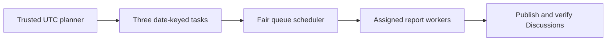

This example replaces independent report schedules with one dispatcher. Each day it admits three report tasks to a work queue; workers publish GitHub Discussions for their assigned reporting windows.

The [dispatcher source](https://github.com/github/gh-aw/blob/main/.github/workflows/daily-report-dispatcher.md) and [shared worker instructions](https://github.com/github/gh-aw/blob/main/.github/workflows/shared/daily-report-worker.md) are the complete implementation. They require deployed workers and approved dispatch targets; compiling alone does not provision the queue or launch reports.

## Report workers

| Worker source | Report |
| --- | --- |
| [daily-compiler-quality](https://github.com/github/gh-aw/blob/main/.github/workflows/daily-compiler-quality.md) | Compiler quality |
| [daily-evals-report](https://github.com/github/gh-aw/blob/main/.github/workflows/daily-evals-report.md) | Evals adoption and results |
| [daily-firewall-report](https://github.com/github/gh-aw/blob/main/.github/workflows/daily-firewall-report.md) | Firewall operation |
| [daily-issues-report](https://github.com/github/gh-aw/blob/main/.github/workflows/daily-issues-report.md) | Issue activity |
| [daily-observability-report](https://github.com/github/gh-aw/blob/main/.github/workflows/daily-observability-report.md) | Workflow observability |
| [daily-regulatory](https://github.com/github/gh-aw/blob/main/.github/workflows/daily-regulatory.md) | Report compliance |
| [daily-repo-chronicle](https://github.com/github/gh-aw/blob/main/.github/workflows/daily-repo-chronicle.md) | Repository trends |
| [daily-secrets-analysis](https://github.com/github/gh-aw/blob/main/.github/workflows/daily-secrets-analysis.md) | Secret references, never values |
| [daily-team-evolution-insights](https://github.com/github/gh-aw/blob/main/.github/workflows/daily-team-evolution-insights.md) | Team collaboration |
| [daily-token-consumption-report](https://github.com/github/gh-aw/blob/main/.github/workflows/daily-token-consumption-report.md) | AI Credit consumption |
| [deep-report](https://github.com/github/gh-aw/blob/main/.github/workflows/deep-report.md) | Intelligence synthesis |
| [artifacts-summary](https://github.com/github/gh-aw/blob/main/.github/workflows/artifacts-summary.md) | Artifact storage; Sunday admission |
| [repo-tree-map](https://github.com/github/gh-aw/blob/main/.github/workflows/repo-tree-map.md) | Repository structure; Monday admission |

## Daily admission

The dispatcher runs daily around 12:00 UTC. A trusted preparation step derives the previous complete UTC report date from the original run's `created_at`, freezes the analysis window, and stages three immutable tasks:

- **DeepReport** receives one slot every day and synthesizes previously published reports over seven days.
- **Weekly reports** replace a rotating slot on Sundays and Mondays.
- **Ten other profiles** rotate through the remaining slots, each receiving six admissions in any 35-day period.

The tasks are independent, not a report-to-report dependency chain. Reusing a date/profile identity requires the exact same payload. The schedule has no manual trigger and admits only on `github.run_attempt == 1`; this is not a queue-enforced daily quota.



The preparation step stages submission and dispatch intents. The agent reads the plan and queue snapshot; it must not submit again, choose winners, or call ordinary dispatch tools.

## Dispatch and publication

The dispatcher requests pool `daily-reports` with `max_claims: 3` and `max_dispatches: 3`. Equal-weight profiles use singleton assignments. These are ceilings: older work, pauses, or occupied capacity can delay today's reports. Three admitted tasks do not guarantee three launches or Discussions.

Each worker reads the original assignment's `work.report_date` and `work.report_profile`, stages its Discussion with the original `claim_handle`, then finishes that Claim. A required report needs independently verified delivery before the queue records Result.

If there is no qualifying data, the worker stages a scoped `noop` and finishes as `cancelled`, not completed. Only effects declared in the immutable contract are allowed. DeepReport additionally permits bounded issues, comments, and diagnostic artifacts; these do not replace its required Discussion. Its cache history is separate from queue authority, and legacy Git memory is not automatically migrated.

## Deploy and inspect

Follow the [native queue deployment sequence](/gh-aw/patterns/workqueue-ops/#deploy-a-native-queue), using the linked portfolio sources. Merge the `daily-reports` pool into shared `aw.json`; preserve other pools. The first authorized submission creates Policy and Work together.

For an installed portfolio, drain existing Claims before changing Policy or worker revisions. Resume on a date not already admitted by the old planner. The 30-pending-task limit rejects excess admission rather than hiding an unlimited backlog.

```bash
gh aw work-queue --repo OWNER/REPO state
gh aw work-queue --repo OWNER/REPO tui
gh aw work-queue --repo OWNER/REPO replay --json
```

Use the [queue reference](/gh-aw/reference/work-queue/) for scheduling, cancellation, reconciliation, and [diagnostic artifacts](/gh-aw/reference/work-queue/#diagnostic-artifacts). Unknown launches retain reservations until exact evidence permits release; rerunning effects is not recovery.

For a write-capable factory with memory snapshots, see [Linter Factory](/gh-aw/gallery/linter-factory/). The reusable orchestration pattern is [WorkQueueOps](/gh-aw/patterns/workqueue-ops/).
