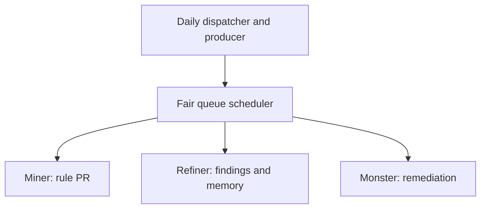

The ESLint factory coordinates three workers through one daily dispatcher. Workers develop rules, review diagnostics, and arrange remediation; the work queue bounds assignments and verifies their outputs.

## Factory roles

| Workflow source | Task | Bounded outputs |
| --- | --- | --- |
| [Dispatcher](https://github.com/github/gh-aw/blob/main/.github/workflows/eslint-factory-dispatcher.md) | Admit the daily cohort and request eligible work | Three independent tasks and a dispatch request |
| [Miner](https://github.com/github/gh-aw/blob/main/.github/workflows/eslint-miner.md) | Implement a useful ESLint rule | One draft PR per Claim |
| [Refiner](https://github.com/github/gh-aw/blob/main/.github/workflows/eslint-refiner.md) | Find false positives, edge cases, and weak diagnostics | Up to three issues, a discussion, and one memory snapshot |
| [Monster](https://github.com/github/gh-aw/blob/main/.github/workflows/eslint-monster.md) | Group diagnostics and arrange remediation | Bounded issue changes, Copilot assignments, and a discussion |

These are complete workflow sources, not a pre-provisioned deployment. Follow [native queue setup](/gh-aw/patterns/workqueue-ops/#deploy-a-native-queue) to publish assignment-capable workers, approve their routes, and configure shared scheduling.

## One daily cohort

A trusted preparation step stages one independent task per worker, keyed by the original dispatcher run's UTC creation date. Scheduled/manual runs and reruns on that date reuse the same identities and payloads. A new day admits a new cohort.

The dispatcher uses pool `default` and requests at most three Claims and three dispatches. The agent reads and explains the prepared plan; it must not submit or dispatch it again. Older eligible tasks may run first.



This is **not** a miner → refiner → monster pipeline. A PR or refinement issue does not automatically submit the next task. Dependencies require explicit Work admission.

Shared `aw.json` sets concurrency three, a pending-task limit of 30, three attempts, and 30-second backoff. Profiles use singleton assignments by default. The first authorized submission atomically creates Policy and Work; dispatch alone cannot bootstrap an absent queue.

## Assignment-scoped outputs

Workers declare:

```yaml
tools:
  work-queue:
    worker: true
    require-assignment: true
```

The compiler supplies the authenticated assignment input; do not declare or manually manufacture it. Workers consume each assigned Claim and use its original `handle` as `claim_handle` on outputs and finish calls.

The immutable task contract limits resource scope and output counts. If no rule or remediation is needed, cancel the write-capable task instead of treating `noop` as verified delivery. A clean ESLint scan requires checking diagnostics: exit zero can include warnings.

If Policy permits multi-Claim batches, each member retains separate outcomes and budgets. Cancelling one member does not make the remaining member an implicit singleton; explicit original selectors remain required.

Completion precedes effects. Result is recorded only after independent verification of the entire required contract, not merely a successful job or API response.

## Refiner memory

The refiner calls `persist_eslint_memory` with structured findings, strategy, metrics, next actions, and the assigned Work ID. Its configuration uses [`tools.work-queue.memory`](/gh-aw/reference/work-queue/#claim-scoped-memory), not unrestricted repository writes.

Protected publication creates an immutable snapshot under `memory/eslint-refiner-runs/claims/<trusted-namespace>`. Legacy `memory/eslint-refiner` history remains read-only. The preparation step exposes validated history to the agent; missing required history is an error, not an empty past. Memory is evidence, never instructions or Claim authority.

## Inspect and recover

Use a CLI version matching the deployed queue protocol:

```bash
gh aw work-queue --repo OWNER/REPO stats --json
gh aw work-queue --repo OWNER/REPO state --json --limit 32
gh aw work-queue --repo OWNER/REPO explain --pool default --json
gh aw audit RUN_ID --repo OWNER/REPO --no-baseline --json
```

An uninitialized queue is expected before the first trusted submit. A denied Git read is an error, not an empty queue. Check the staged plan and authoritative ledger rather than accepting a green dispatcher run as proof of admission.

For `native_capacity_blocked`, inspect the original dispatch with `evidence --dispatch-id DISPATCH_ID` and reconcile exact termination with `reconcile --dispatch-id DISPATCH_ID`. Do not blindly relaunch uncertain effects, release reservations on elapsed time alone, or delete the ledger.

See the [queue reference](/gh-aw/reference/work-queue/) for exact controls and the [bounded factory model](https://github.com/github/gh-aw/blob/main/specs/eslint-factory/README.md) for checked scenarios and abstraction limits. [Daily Report Portfolio](/gh-aw/gallery/daily-report-portfolio/) applies the same queue to report rotation; [WorkQueueOps](/gh-aw/patterns/workqueue-ops/) describes the reusable pattern.
