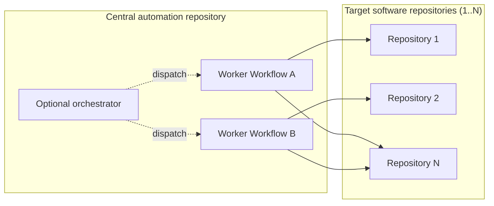
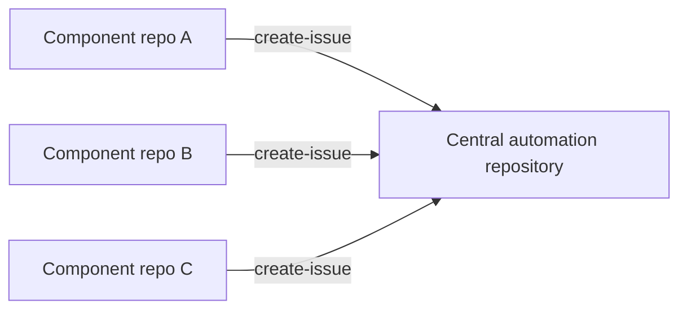

CentralRepoOps uses a **central automation repository** to host automation targeting software in one or more other repositories, or to aggregate their activity. It is a sub-pattern of [MultiRepoOps](/gh-aw/patterns/multi-repo-ops/). The repository can run workers, with or without an orchestrator, or collect events from component repositories.

<span id="using-a-central-control-repository"></span>

## Using a Central Automation Repository

A central automation repository holds the workflows, schedules, and credentials; the software being improved stays in the target repositories. Workers run in the automation repository and open issues or pull requests against those targets. An orchestrator is optional.



### Self-Scheduling Workers

The simplest deployment is a set of independent workers, each with its own schedule and target repositories. For example, a test improver periodically adds missing tests in one repository, while a performance improver benchmarks and proposes optimizations in one or more repositories. Neither needs an orchestrator or dispatch workflow.

Each worker defines its own `on.schedule`, reads or checks out the target software, and uses cross-repository safe outputs to propose changes. The workflows remain in the central repository; they do not need to be installed in the software repositories.

### Optional Orchestration

Add an orchestrator when work needs shared prioritization, target selection, or phased rollout across repositories. It dispatches workers in the central repository with a target repository as input. Workers can be dispatch-only or also retain their own schedules.

The following example shows the orchestrated variant. It supports pilot waves and a central decision trail without installing workflows in each target repository.

**Orchestrator** (`dispatch-workflow` safe output + `max` limit):
```aw wrap
---
on:
  schedule: weekly on monday

tools:
  github:
    github-token: ${{ secrets.GH_AW_READ_ORG_TOKEN }}
    toolsets: [repos]

safe-outputs:
  dispatch-workflow:
    workflows: [worker-workflow]
    max: 5
---

# Rollout Orchestrator

Filter repositories, categorize by complexity, prioritize the rollout order, and dispatch the worker workflow for each selected repository. Summarize candidates, breakdown, and rationale.
```

**Worker** (`checkout` + `target-repo` safe outputs per dispatched repo):
```aw wrap
---
on:
  workflow_dispatch:
    inputs:
      target_repo:
        description: 'Target repository (owner/repo format)'
        required: true
        type: string

checkout:
  repository: ${{ github.event.inputs.target_repo }}
  github-token: ${{ secrets.ORG_REPO_CHECKOUT_TOKEN }}
  current: true

safe-outputs:
  github-token: ${{ secrets.GH_AW_CROSS_REPO_PAT }}
  create-pull-request:
    target-repo: ${{ github.event.inputs.target_repo }}
    max: 1
---

# Worker: Apply Changes to Target Repository

Analyze ${{ github.event.inputs.target_repo }}, apply the required changes, and create a pull request explaining what was changed and why.
```

When using an orchestrator, keep its permissions narrow and delegate repo-specific writes to workers. Add correlation IDs to dispatch inputs for tracking. See the [Dependabot Rollout example](/gh-aw/gallery/multi-repo/dependabot-rollout/) for a complete end-to-end walkthrough.

<span id="using-a-central-tracker-repository"></span>

## Aggregating Events

Each component repository runs its own workflow that forwards events to the central automation repository via `target-repo`. The central repository accumulates a unified view without needing direct access to individual component repos.



Useful for component-based architectures where multiple teams need a shared visibility layer, cross-project initiatives, or aggregating metrics from distributed repositories. See [Cross-Repo Issue Tracking](/gh-aw/gallery/multi-repo/issue-tracking/) for a complete example.

## Learn More

- [MultiRepoOps](/gh-aw/patterns/multi-repo-ops/) — Side repo and downstream sync patterns
- [Dependabot Rollout](/gh-aw/gallery/multi-repo/dependabot-rollout/) — End-to-end org-wide rollout example
- [Cross-Repo Issue Tracking](/gh-aw/gallery/multi-repo/issue-tracking/) — Aggregated issue tracking example
- [Cross-Repository Safe Outputs](/gh-aw/reference/cross-repository/) — Configuration reference
- [Authentication](/gh-aw/reference/auth/) — PAT and GitHub App setup
