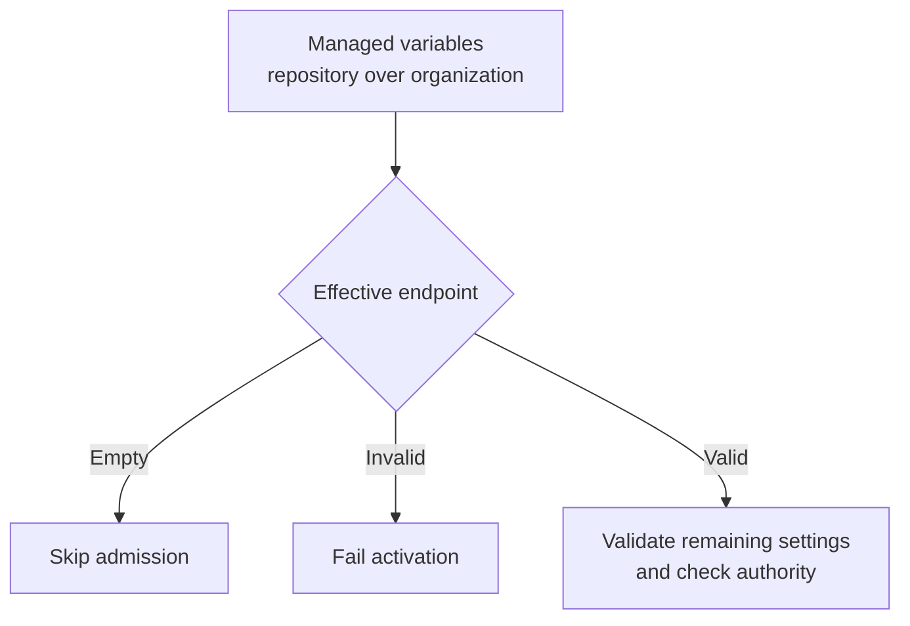
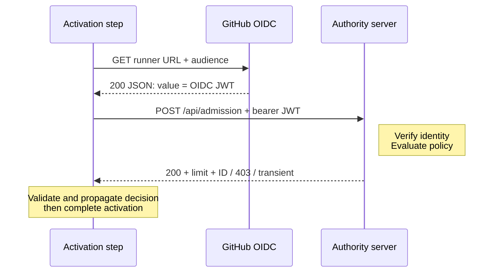
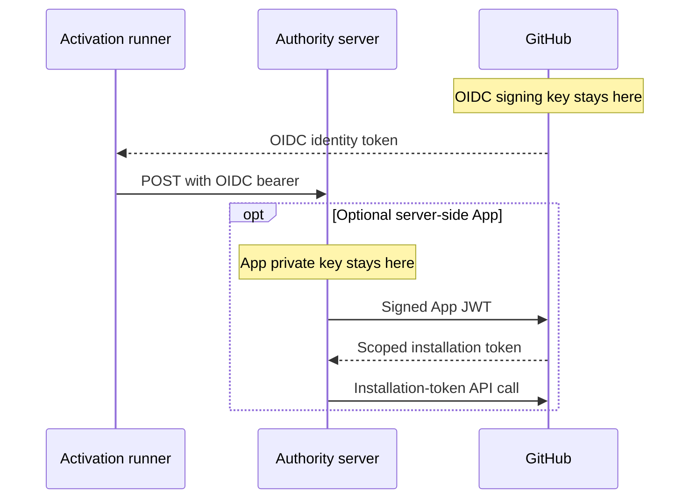
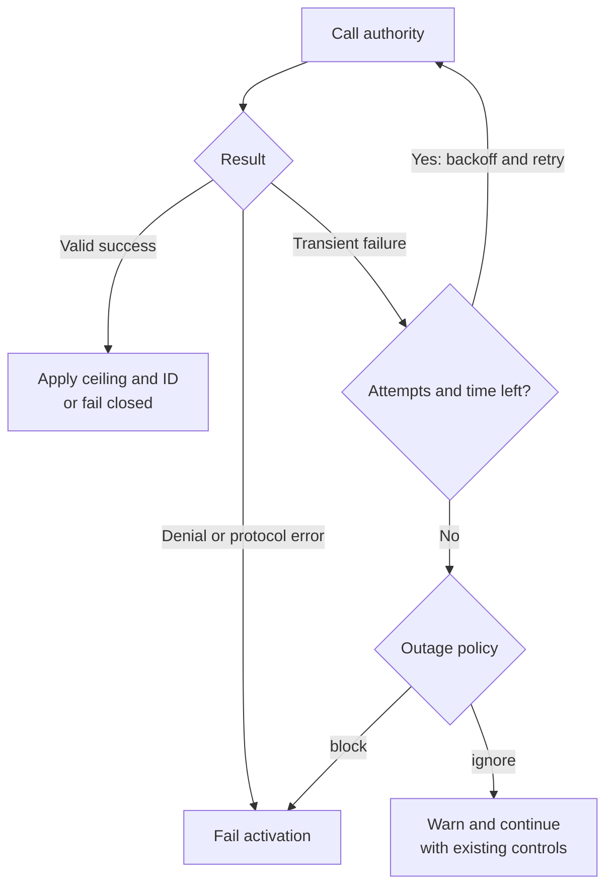
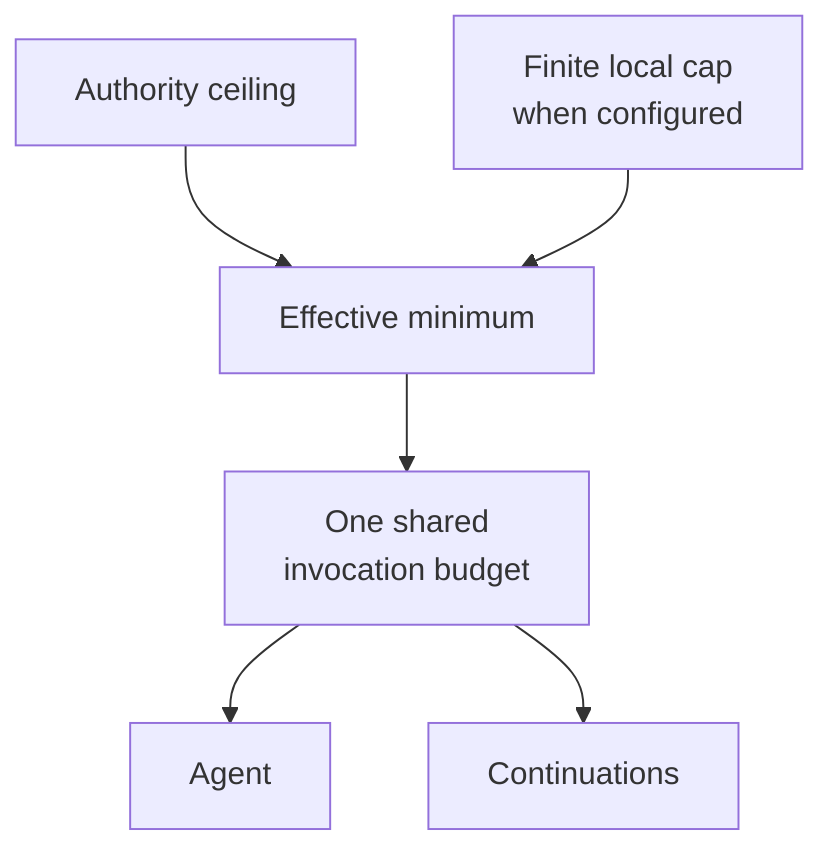

**Version**: 1.0 draft<br />
**Status**: New feature proposal; no admission implementation yet<br />
**Date**: 2026-10-19

The terms MUST, MUST NOT, SHOULD, and MAY indicate normative requirements. This document specifies a new feature. No admission client or service implementation exists yet; all admission-specific behavior described here remains to be implemented.

## 1. Scope and Ownership

The proposed feature adds admission as a step in gh-aw's existing activation job, before agent execution. It MUST NOT add a job or a new job dependency. Once implemented, gh-aw MUST include admission support by default: managed Actions variables automatically enable the check, without a separate opt-in flag. Without a configured endpoint, the step is skipped or completes as a successful no-op, and activation continues normally. A deployment-selected **admission authority server** (the authority) MUST implement the HTTPS admission service, trusted usage ingestion, policy evaluation, and protected operator diagnostics. It MAY use a server-side GitHub App for backend verification and configuration provisioning.

The gate is a **cooperative admission check** for participating workflows, not an unbypassable organization policy or hard spending cap. It decides whether a cooperating AW execution may start and returns its maximum AI Credits allowance and a service-issued opaque correlation ID. It is not a billing API, spend-inspection endpoint, inference proxy, or mid-execution cancellation mechanism.

The protocol uses REST POST with a JSON body, authenticated exclusively by a GitHub Actions OIDC identity token with an audience restricted to the intended authority deployment. The client MUST NOT send `GITHUB_TOKEN`, a PAT, Copilot token, GitHub App JWT, installation access token, App private key, API key, or custom activation credential to the admission service. The feature MUST support only this protocol, with no GET, alternate authentication mode, negotiation, or credential fallback.

## 2. Configuration and Provisioning

### Managed Environment Variables

Admission configuration MUST come exclusively from managed GitHub Actions variables, resolved at workflow runtime and passed to the admission step as environment variables. Repository JSON files and workflow/frontmatter configuration MUST NOT define or override admission settings. The compiler MUST register these variables with the existing `gh aw env get/update` mechanism:

| Actions variable | Managed YAML field | Built-in fallback |
|------------------|--------------------|-------------------|
| `GH_AW_DEFAULT_ADMISSION_URL` | `default_admission_url` | Empty; gate disabled |
| `GH_AW_DEFAULT_ADMISSION_AUDIENCE` | `default_admission_audience` | Effective endpoint URL |
| `GH_AW_DEFAULT_ADMISSION_ON_OUTAGE` | `default_admission_on_outage` | `ignore` |

The corresponding managed-defaults YAML is:

```yaml
default_admission_url: https://admission.example.org/api/admission
default_admission_audience: https://admission.example.org/api/admission
default_admission_on_outage: ignore
```

The service route is `/api/admission`; the deployment origin is configurable. A nonempty URL MUST be the full absolute HTTPS URL for that route, without embedded credentials, query parameters, fragments, or GitHub Actions expressions. A nonempty audience MUST be a literal deployment-specific value without control characters or expressions. It identifies the intended recipient; it is not a secret or a GitHub App identifier.

Each effective runtime variable takes precedence over its built-in fallback; repository Actions variables override organization variables. Enterprise-wide rollout provisions organization variables in each enrolled organization, not an assumed native enterprise Actions-variable scope. Compiler-process environment variables MUST NOT determine these values, and workflow-local configuration MUST NOT introduce another override layer. A configured endpoint automatically enables admission. An unset or empty endpoint makes the check a no-op; an audience or outage policy alone MUST NOT enable it. A nonempty but invalid endpoint MUST fail validation, not silently disable the check.



The compiler MUST always emit the runtime variable hooks, so enabling, disabling, or changing managed settings does not require recompilation after the feature is available in a compiled workflow. Existing managed-default update semantics remain unchanged: omitted or null YAML fields delete the corresponding variable at the selected scope. Operators MUST preserve other defaults when updating a defaults file.

Managed variables distribute configuration, not locked policy. Repository Actions variables override same-named organization variables: a principal permitted to manage repository variables can shadow the organization endpoint with an empty or different value, change the audience, or select `ignore`. Workflow editors can also omit the step or change its environment wiring. Consequently, these variables cannot mandate participation or prevent bypass; an empty endpoint and default fail-open behavior are intentional availability choices.

Stronger enforcement requires the controlled AI/backend resource to independently authorize usage and enforce authoritative quota or reservations, with protected configuration and workflow identities. The admission call alone does not provide that boundary. HTTPS validation alone does not establish an approved destination; deployments SHOULD enforce approved origins and runner egress independently.

### GitHub App Responsibilities

When the authority uses a GitHub App for provisioning or verification, that App requires a private key. That key MUST remain in the authority's protected server-side secret storage, with access control, rotation, and audit. It MUST NOT be distributed to workflows, Actions variables, workflow secrets, artifacts, or responses.

The App MUST be installed on the relevant organization or repository-owning account, with approved permissions and repository access for the chosen operations. Requested registration permissions are not sufficient: installation owners must approve new permissions before they become available. An enterprise installation does not substitute for the organization installation and organization permissions needed to manage organization Actions variables.

The authority MUST follow GitHub's [App JWT authentication](https://docs.github.com/en/apps/creating-github-apps/authenticating-with-a-github-app/generating-a-json-web-token-jwt-for-a-github-app) and [installation-token generation](https://docs.github.com/en/apps/creating-github-apps/authenticating-with-a-github-app/generating-an-installation-access-token-for-a-github-app) specifications. Sign the App JWT using `RS256`, include an issued-at timestamp in `iat` and the App's client ID or application ID in `iss`, and set `exp` no more than ten minutes into the future. GitHub recommends the client ID and an `iat` sixty seconds in the past for clock skew. Use that JWT as a bearer credential for App-level operations, including [`POST /app/installations/{installation_id}/access_tokens`](https://docs.github.com/en/rest/apps/apps#create-an-installation-access-token-for-an-app); use the resulting installation token, not the App JWT, for the organization/repository APIs below.

Installation IDs MUST come from trusted tenant enrollment and authoritative GitHub installation metadata, bound to the verified repository owner and repository. Unverified request fields MUST NOT select another tenant's installation. Installation tokens expire after one hour; honor GitHub's returned `expires_at` and renew as needed. Treat tokens as opaque, without fixed-length or format assumptions. Scope tokens with the documented `permissions` and, for repository operations, `repositories` or `repository_ids` parameters to only the approved access needed; tokens cannot expand an installation's grants. Provisioning and verification tokens SHOULD have separate least-privilege scopes.

The following permissions apply only when the authority performs the corresponding operation, following GitHub's [App permission matrix](https://docs.github.com/en/rest/authentication/permissions-required-for-github-apps) and [Actions variables API](https://docs.github.com/en/rest/actions/variables):

| Backend operation | Required GitHub App permission |
|-------------------|--------------------------------|
| Create/update/delete organization variables or bulk-set their selected repositories | Organization **Variables: write** |
| Read organization variables | Organization **Variables: read** |
| Create/update/delete repository variables | Repository **Variables: write** |
| Read repository variables or organization variables shared with a repository | Repository **Variables: read** |
| Verify workflow runs, attempts, or jobs through the Actions API | Repository **Actions: read** |
| Read workflow/source files for trusted logical-ID mapping, if used | Repository **Contents: read** |

Organization and repository Variables are distinct permission categories; repository **Actions: write** is not the variable-write permission. Contents write, Workflows write, Secrets, Checks write, and Deployments write are not required for the operations in this table. Individual add/remove-selected-repository variable endpoints have additional permission requirements; implementations MUST check the selected endpoint rather than assume all visibility-management endpoints have identical grants.

With administrator authorization and the applicable installation grants, the App MAY provision only the non-secret admission URL, audience, and outage defaults at supported organization/repository scopes. Enterprise-wide provisioning requires authorized organization installations for each target organization. Unsupported provisioning, missing approvals, or insufficient permissions MUST be reported to the administrator, not silently bypassed or replaced with a PAT.

Only non-secret configuration is provisioned. App IDs and installation IDs do not authenticate a workflow. The App does not mint the workflow's OIDC token.

## 3. Activation Step and Request Contract

gh-aw MUST add the admission step to the existing activation job after applicable trigger/authorization prechecks, trusted setup, and execution-context initialization, but before agent execution and cost-incurring task work. The step MUST use trusted, pinned bootstrap and admission code, not execute repository-supplied task scripts. No separate admission job is created.

The activation job MUST gain `id-token: write` to request OIDC tokens, while retaining only the GitHub API permissions required by its other steps. Permissions are job-scoped, not step-scoped; the admission step MUST NOT use or forward the activation job's GitHub API token or other available secrets. When no effective endpoint exists, the step MUST be skipped or succeed as a no-op without requesting an identity token or making a service call. Skipping the step MUST NOT skip activation or its downstream jobs. A blocking admission failure MUST fail activation and prevent agent execution through the existing activation-success dependency.

The entire activation job is an OIDC trust boundary, not just the admission step. All custom setup, pre, and regular steps and actions, before and after admission, MUST be reviewed as able to request identity tokens for any audience, including the admission audience. OIDC attests workflow/job identity, not which step requested the token; the authority MUST NOT treat it as proof that the trusted admission helper ran. Skipping admission does not revoke the job's OIDC capability. The implementation MUST prevent untrusted code from executing in this job and review existing federated relying-party policies before granting the permission; an admission-step condition is not a permission sandbox. Trusted repository-maintained hooks remain within this cooperative boundary, without adding a job or claiming step-level isolation.

The journey below uses GitHub.com endpoints. Other supported GitHub deployments require independently configured issuer and API hosts. Credential placeholders and decoded token examples are synthetic, not usable credentials. The GitHub response excerpts omit unrelated fields; the admission request and success bodies are complete.

### Protocol Flow



The step first resolves the endpoint and remaining settings as specified in Section 2. No endpoint means no token or request. For an enabled gate, it snapshots the current execution's nine identity strings, acquires the token below, and sends the admission request. The authority verifies the token and request bindings as specified in Section 4, optionally verifies run-attempt metadata, and returns the Section 5 decision. Only then does the client follow [Continuing After Admission](#continuing-after-admission). Transient retries follow Section 6 without changing the invocation or creating another entitlement.

### Requesting the OIDC Token

GitHub supplies `ACTIONS_ID_TOKEN_REQUEST_URL` and `ACTIONS_ID_TOKEN_REQUEST_TOKEN` to the job when its effective permissions allow OIDC issuance. The permission requirement and both acquisition methods are documented in GitHub's [OIDC permissions](https://docs.github.com/en/actions/reference/security/oidc#workflow-permissions-for-the-requesting-the-oidc-token) and [methods for requesting the OIDC token](https://docs.github.com/en/actions/reference/security/oidc#methods-for-requesting-the-oidc-token). A reusable workflow cannot elevate permissions denied by its caller.

The trusted helper requests the effective audience explicitly through GitHub's documented [`core.getIDToken(audience)` API](https://docs.github.com/en/actions/reference/security/oidc#standard-audience-issuer-and-subject-claims):

```javascript
const oidcToken = await core.getIDToken(effectiveAudience);
```

For `effectiveAudience = "https://admission.example.org/api/admission"`, the equivalent exchange is:

```http
GET <ACTIONS_ID_TOKEN_REQUEST_URL>&audience=https%3A%2F%2Fadmission.example.org%2Fapi%2Fadmission HTTP/1.1
host: <host from ACTIONS_ID_TOKEN_REQUEST_URL>
authorization: bearer <ACTIONS_ID_TOKEN_REQUEST_TOKEN>
accept: application/json

HTTP/1.1 200 OK
content-type: application/json

{
  "value": "<OIDC_JWT>"
}
```

The request URL is the complete, job-issued URL, including its existing query parameters; the audience is URL-encoded once and appended as documented. It MUST NOT be replaced with the public issuer/discovery URL or a guessed GitHub REST endpoint. `ACTIONS_ID_TOKEN_REQUEST_TOKEN` is the runner's bootstrap bearer credential for this GitHub request only. The response's `value` is a different credential: the signed OIDC identity JWT that authenticates to the authority. Neither credential is `GITHUB_TOKEN`, and no App key, App JWT, or installation token is involved in runner-side acquisition.

The helper MUST keep both credentials in memory, mask the acquired token, and send only the OIDC JWT to the authority. It MUST NOT print either credential, decode a live token into diagnostics, or publish tokens through step/job outputs. The toolkit call illustrates the API, not a complete client: acquisition and any internal retries MUST satisfy Section 6's bounded deadline and generic-error requirements.

See [Runtime-Minted Token Revocation](#runtime-minted-token-revocation) for OIDC disposal versus installation-token revocation.

### HTTP Request

The service accepts `POST /api/admission`, with `content-type: application/json`, `cache-control: no-store`, and an `authorization` header containing the bearer OIDC identity token. Execution metadata belongs in the JSON body, not the URL. There are no query parameters. Other HTTP methods MUST NOT admit execution or evaluate spending policy; the client MUST NOT fall back to GET.

```http
POST /api/admission HTTP/1.1
host: admission.example.org
authorization: bearer <OIDC_JWT>
content-type: application/json
cache-control: no-store
traceparent: 00-4bf92f3577b34da6a3ce929d0e0e4736-00f067aa0ba902b7-01

{
  "repo": "acme/project",
  "workflow_id": "acme/project/.github/workflows/triage.lock.yml@refs/heads/main",
  "workflow_call_id": "1234-2:acme/project/.github/workflows/triage.lock.yml@refs/heads/main",
  "run_id": "1234",
  "run_attempt": "2",
  "ref": "refs/heads/main",
  "event_type": "workflow_dispatch",
  "actor": "octocat",
  "triggering_actor": "hubot"
}
```

`<OIDC_JWT>` means exactly the token returned in the preceding response's `value`, not the bootstrap request token. The `authorization` header MUST be present, and the token MUST appear nowhere else, including the body, URL, trace context, diagnostics, outputs, artifacts, or response. The example includes `traceparent` for an OTel-enabled AW; this header is optional when OTel is disabled. Redirects MUST NOT be followed.

This POST targets the configured authority, not `api.github.com`. It is the proposed API defined by this specification, not a GitHub REST API. The authority consumes the OIDC token directly and returns an admission decision; there is no intermediate exchange for a cloud access token or a credential for continuing the workflow.

### Proxy-Friendly Header Conventions

Emit lowercase HTTP field names and accept them case-insensitively. When propagating trace context, use the standard W3C `traceparent` field through an OpenTelemetry propagator, not `trace-parent`, `otel-traceparent`, or `x-trace-id`. The required standard request fields are `authorization`, `content-type`, and `cache-control`; `traceparent` is conditional on AW OTel enablement.

Any future custom header MUST use the lowercase `gh-aw-` namespace followed by ASCII alphanumeric, hyphen-separated words: `gh-aw-[a-z0-9]+(?:-[a-z0-9]+)*`. Do not use underscores, spaces, dotted OTel attribute names, or an `x-` prefix. This protocol defines no custom headers. The service-issued correlation ID is returned in JSON and propagated as an OTel attribute; it MUST NOT replace `traceparent`.

Proxies and API gateways MUST allow and preserve the standard fields, without appending or comma-joining `traceparent` values, rewriting trace IDs, or caching admission responses. They MUST NOT forward arbitrary caller headers or use forwarded-host headers to select an issuer, audience, or tenant. Document transport limits that accommodate valid GitHub OIDC tokens and trace context. Infrastructure header/body limits still apply before protocol processing.

### JSON Request Fields

All nine fields are required exactly once in a UTF-8 JSON object. Every value is a string, including run IDs and attempt numbers. Standard runner sources below are defined in GitHub's [default environment variables](https://docs.github.com/en/actions/reference/workflows-and-actions/variables#default-environment-variables); the executing workflow reference uses gh-aw's existing metadata wiring:

| Field | Meaning and validation |
|-------|------------------------|
| `repo` | `GITHUB_REPOSITORY`: current execution's `owner/repository` slug; MUST match signed `repository` |
| `workflow_id` | `GH_AW_INFO_WORKFLOW_ID`, populated from `job.workflow_ref`, matching `aw_info.workflow_id`: `owner/repository/.github/workflows/file.yml@ref`; neither a short logical AW ID nor a numeric GitHub workflow ID |
| `workflow_call_id` | Derive exactly `<run_id>-<run_attempt>:<workflow_id>`, matching `aw_info.workflow_call_id`; not a separate GitHub claim |
| `run_id` | `GITHUB_RUN_ID`: positive decimal run ID; preserve as a string and compare with signed `run_id` |
| `run_attempt` | `GITHUB_RUN_ATTEMPT`: positive decimal attempt number; MUST match signed `run_attempt` |
| `ref` | `GITHUB_REF`: current GitHub Actions ref; MUST match signed `ref` |
| `event_type` | `GITHUB_EVENT_NAME`: current event name; MUST match supported signed `event_name` |
| `actor` | `GITHUB_ACTOR` / `github.actor`: original run actor login; MUST match signed `actor` |
| `triggering_actor` | `GITHUB_TRIGGERING_ACTOR` / `github.triggering_actor`: current attempt's initiator, which may differ from `actor`; not an OIDC claim |

The client MUST pass both values from the current [GitHub Actions context](https://docs.github.com/en/actions/reference/workflows-and-actions/contexts#github-context), not infer one from the other. `actor` identifies the original run actor; `triggering_actor` identifies the current attempt's initiator. GitHub reruns retain the privileges of `github.actor`, even when `github.triggering_actor` has different privileges. Actor-specific authorization MUST use verified identity, including signed `actor_id`, and MUST NOT substitute the rerun initiator's privileges for the original actor's.

`triggering_actor` is not a documented GitHub OIDC claim and MUST NOT be assumed to be signed by the identity token. Until independently verified, it is informational request metadata, not an authorization or accounting identity. Before using it for policy or budget attribution, the authority MUST compare it with authoritative [workflow run-attempt metadata](https://docs.github.com/en/rest/actions/workflow-runs#get-a-workflow-run-attempt) bound to the signed repository, run ID, and attempt, and use the verified account ID where identity stability is required. An App-backed lookup requires repository **Actions: read**. A policy depending on this identity MUST NOT fall back to unverified data or a more permissive policy when verification fails.

The client derives fields from the current runner context and executing workflow reference, not caller-supplied `aw_context`. Existing gh-aw populates `GH_AW_INFO_WORKFLOW_ID` from `job.workflow_ref` and builds `aw_info.workflow_call_id` with `buildWorkflowCallId`; admission MUST preserve those semantics. For reusable workflows, `github.workflow_ref` and `GITHUB_WORKFLOW_REF` identify the caller and MUST NOT replace the executing reference. Missing executing identity or run attempt MUST block admission rather than use the metadata helper's empty-reference or default-attempt fallback. The request sends no full event payload, arbitrary inbound context, usage, balances, or policy values. Original triggering-event lineage is not part of this protocol.

The service MUST reject missing, duplicate, unknown, malformed, empty, or oversized fields, non-object bodies, non-string values, unsupported content types, and request query parameters. It MUST impose documented body/header limits and SHOULD support an 8 KiB JSON body. Invalid UTF-8, control characters, invalid repository slugs, non-positive run numbers, or inconsistent invocation IDs receive the uniform denial. Body values MUST NOT be interpreted as executable expressions, outbound URLs, or credential selectors.

JSON member names and string values in requests and success responses MUST decode to Unicode scalar-value sequences. Unpaired surrogate escapes MUST be rejected, not replaced; valid surrogate pairs remain supported. Decode JSON escapes exactly once and compare decoded identifiers exactly, without case folding or Unicode normalization. Invalid request strings receive the uniform denial; invalid success strings are blocking protocol failures.

Opaque identifiers and refs MUST NOT be unnecessarily split. Large decimal identifiers MUST NOT pass through floating-point conversion.

### OpenTelemetry Correlation

When OTel is enabled for the AW, the client MUST propagate distributed trace context with the standard W3C `traceparent` header. When OTel is disabled, `traceparent` is optional: no client trace generation, propagation, or export is required solely for admission. The authority and its ingress MUST NOT require this header for authentication or admission. When present, its 32-character lowercase hexadecimal trace ID is independent of the service-issued `correlation_id`. The version-00 form is `00-<trace-id>-<client-span-id>-<trace-flags>`, with a nonzero trace ID and a nonzero 16-character span ID. Implementations MUST use a standards-compliant propagator rather than interpolate arbitrary input.

For OTel-enabled AWs, reuse a valid AW trace context through the existing OTLP helpers. If none exists, generate a cryptographically random trace ID, never one derived from repository, actor, run, spend, or a credential. An instrumented admission operation and its HTTP attempts share the trace ID; each HTTP attempt has a distinct client span ID. The authority parents its server span to valid incoming context when present, or starts its own context according to its instrumentation when no header is supplied.

For OTel-enabled AWs, the step MUST preserve the activation job's existing trace context and propagate validated trace/parent IDs through the existing workflow mechanism so agent and conclusion telemetry remain connected. If the step creates a trace because none exists, it MUST initialize that mechanism rather than add a job or dependency. Instrumented logs retain standard `trace_id` and `span_id` correlation; neither tracing nor the service correlation ID substitutes for authenticated invocation identity or an idempotency key.

After validating the successful response, the client MUST attach `correlation_id` as the common OTel resource attribute `gh-aw.admission.correlation_id` to all subsequent OTLP records for the admitted invocation, including the completed admission span, remaining activation, engine, tool/gateway, safe-output, and conclusion telemetry. This includes spans, logs, and metrics across jobs and subprocesses, including telemetry emitted on later failure or cancellation. Components that cannot set the attribute directly MUST be enriched through the shared export path; supported telemetry paths MUST NOT silently omit it.

The authority MUST add the same attribute to its admission server span and subsequent invocation-specific span/log records, without mutating shared service resource identity or mixing invocation IDs.

The validated ID MUST propagate through existing step/job outputs and runtime environment/context, without adding a job. The service-issued ID remains required on success and available independently of AW OTel enablement; retaining it MUST NOT enable telemetry export. Exporters MUST preserve it independently of trace/span IDs and prevent user-supplied context or custom attributes from replacing it. Already-emitted telemetry is not rewritten or resent; existing W3C trace context connects records emitted before admission. Independently admitted invocations receive their own service-scoped IDs rather than trusting an inherited caller value.

Trace and service correlation IDs MUST NOT be used as metric datapoint dimensions, public metric labels, or authorization to access another tenant's telemetry. Metrics carry correlation only as protected resource metadata; exporters MUST NOT promote it to high-cardinality metric labels.

Trace context is untrusted observability data, not an authorization claim. Within overall HTTP transport limits, missing, malformed, oversized, or duplicate trace context MUST NOT change admission or outage decisions: the authority discards it and starts a fresh context without echoing or logging raw invalid values. Export failures MUST NOT change the decision, disable the check, or cause another admission request.

Only `traceparent` is propagated across this boundary. Arbitrary `tracestate` and `baggage` MUST NOT be forwarded or reflected; received values are ignored. Sampling is locally controlled and independent of spend, actor privileges, or an attacker-supplied sampled flag. Credentials, policy reasons, usage, balances, and personal metadata MUST NOT be encoded in trace identifiers or propagation headers.

Responses do not echo trace headers or disclose internal reason identifiers. The successful JSON response carries only the authorized run ceiling and an opaque service correlation ID. Detailed service reasons remain in protected, tenant-scoped telemetry and MUST NOT appear in workflow-visible span attributes or events. A denied, skipped, or fail-open execution without a valid success response preserves its existing OTel configuration and MUST NOT fabricate a service-issued correlation ID.

### Continuing After Admission

The authority responds synchronously on the same POST; Section 5 gives the complete response and validation rules. For its example `200`, the activation helper receives `max_ai_credits = 1000` and `correlation_id = "8e53c1f4a62049b5b382704fe9d61a0c"`. It validates the entire response before publishing either field, computes the effective minimum with the existing finite local cap, and wires that limit and ID into the remaining execution. A local cap of `600` yields an effective limit of `600`; an unset local cap leaves the authority ceiling of `1000`.

Only the validated non-secret decision values, never either OIDC credential, cross the existing step/job output and runtime-context boundaries. GitHub documents [passing job outputs](https://docs.github.com/en/actions/how-tos/write-workflows/choose-what-workflows-do/pass-job-outputs), including mapping step outputs to job outputs and consuming them through `needs.<job_id>.outputs`. The compiler MUST integrate this transport into the existing graph, without adding a job or dependency; consumers MUST validate the credit value instead of interpreting a missing or malformed string output as unlimited.

The helper then succeeds, and activation finishes its remaining checks. GitHub Actions schedules the already-dependent agent job only if the existing [job dependency and success conditions](https://docs.github.com/en/actions/reference/workflows-and-actions/workflow-syntax#jobsjob_idneeds) permit it. The authority makes no callback or additional GitHub API call to resume the workflow. The workflow's normal engine credentials remain separate and MUST NOT be sent to the authority.

The agent and its continuations consume the same effective invocation budget; they do not acquire another entitlement by repeating admission. All subsequent supported OTLP records retain the returned resource attribute as described above. If the endpoint is absent or an outage is ignored, there are no service decision values to transport; existing local/default controls remain. A denial, invalid success, or failed budget propagation blocks the agent instead of taking this continuation path.

## 4. Authentication and Trust Boundary

### Secret Locations and Credential Flow

Workflow identity and optional backend credentials use separate token flows:



The App private key and installation tokens never go to the runner. The key signs App JWTs, not workflow OIDC tokens. Managed variables contain only non-secret configuration. The runner's OIDC bootstrap credential is used only with GitHub; `GITHUB_TOKEN` and provider secrets are not used by admission. Transient tokens MUST NOT enter logs, traces, artifacts, or decision storage. All activation steps share the job's OIDC issuance capability, including when the admission step is skipped.

### OIDC Verification

The service MUST authenticate before reading tenant policy or usage. It MUST use a maintained JWT verifier and validate the signature, permitted algorithm, trusted GitHub issuer, exact configured audience, expiry, not-before, and issuance time with bounded clock skew. Unsigned tokens, algorithm confusion, missing required claims, and unexpected claim types MUST be rejected.

Issuer metadata and signing keys MUST come from a deployment-configured trusted GitHub issuer. The service MUST NOT discover an issuer, JWKS endpoint, GitHub API host, or network destination from unverified token, body, or trace data. Signing-key rotation and cache refresh MUST be bounded and tested. An unknown key triggers a bounded trusted refresh; inability to refresh is an outage, while a definitively invalid signature or key is a denial.

For GitHub.com, the authority reads the [discovery metadata documented by GitHub](https://docs.github.com/en/actions/reference/security/oidc#oidc-token-claims):

```http
GET /.well-known/openid-configuration HTTP/1.1
host: token.actions.githubusercontent.com
accept: application/json
```

The relevant response fields are:

```json
{
  "issuer": "https://token.actions.githubusercontent.com",
  "jwks_uri": "https://token.actions.githubusercontent.com/.well-known/jwks",
  "id_token_signing_alg_values_supported": ["RS256"]
}
```

It obtains public verification keys from `jwks_uri`, the signing-key location identified by that [documented GitHub OIDC metadata](https://docs.github.com/en/actions/reference/security/oidc#oidc-token-claims):

```http
GET /.well-known/jwks HTTP/1.1
host: token.actions.githubusercontent.com
accept: application/json
```

Both GETs are unauthenticated public reads: neither the workflow JWT, its bootstrap credential, nor an App credential is sent. These are cacheable issuer/key lookups, not required round trips on every admission. The JWKS response is a JSON object with a `keys` array; RSA entries identify their `kid`, `kty`, `alg`, and `use`, and provide the public modulus `n` and exponent `e`. The authority selects the public RSA signing key using the JWT header's `kid` and verifies `RS256` locally. `kid` is only a lookup key within the trusted set; token-supplied `jku`, `x5u`, or embedded keys MUST NOT select another verification source. The authority does not send the JWT back to GitHub for validation.

The expected audience MUST be configured independently on the authority. It MUST NOT be accepted merely because it matches a request parameter or the token's own `aud` claim. GitHub.com and each supported GitHub Enterprise deployment require explicit issuer/trust configuration; unsupported deployments receive no credential downgrade.

### Decoded OIDC Payload Example

An OIDC JWT has three base64url-encoded components: header, payload, and signature. Its claims are signed, not encrypted; decoding alone does not authenticate them. The following synthetic decoded header and payload correspond to Section 3's non-reusable-workflow request and GitHub's [documented OIDC claims](https://docs.github.com/en/actions/reference/security/oidc#oidc-token-claims):

```json
{
  "typ": "JWT",
  "alg": "RS256",
  "kid": "synthetic-key-1"
}
```

```json
{
  "iss": "https://token.actions.githubusercontent.com",
  "aud": "https://admission.example.org/api/admission",
  "sub": "repo:acme@1000/project@1001:ref:refs/heads/main",
  "repository": "acme/project",
  "repository_id": "1001",
  "repository_owner": "acme",
  "repository_owner_id": "1000",
  "workflow_ref": "acme/project/.github/workflows/triage.lock.yml@refs/heads/main",
  "workflow_sha": "0123456789abcdef0123456789abcdef01234567",
  "run_id": "1234",
  "run_attempt": "2",
  "ref": "refs/heads/main",
  "event_name": "workflow_dispatch",
  "actor": "octocat",
  "actor_id": "101",
  "jti": "synthetic-token-1",
  "iat": 1700000000,
  "nbf": 1700000000,
  "exp": 1700000300
}
```

The dates, IDs, and key identifier are illustrative; this is not a currently valid token. Use the actual verified NumericDate claims, not an assumed fixed token lifetime. The subject illustrates GitHub's [immutable subject format](https://docs.github.com/en/actions/reference/security/oidc#immutable-subject-claims); deployments MUST validate their configured subject policy rather than assume one universal `sub` layout.

There is deliberately no `workflow_id`, `workflow_call_id`, `event_type`, or `triggering_actor` claim: the request maps these as specified in Section 3 and below. For a reusable workflow, GitHub's [documented reusable-workflow token](https://docs.github.com/en/actions/how-tos/secure-your-work/security-harden-deployments/oidc-with-reusable-workflows#how-the-token-works-with-reusable-workflows) additionally identifies the executing workflow with `job_workflow_ref` and `job_workflow_sha`; caller claims remain separate.

### Invocation and Tenant Binding

Authorization MUST use signed immutable `repository_id` and `repository_owner_id`, trusted tenant enrollment, and allowed workflow identities. A valid GitHub signature alone does not authorize an arbitrary repository or tenant.

The service MUST compare repository, run ID, attempt, ref, event, and actor body fields against verified claims. `triggering_actor` follows the separate run-attempt verification requirements in Section 3; no corresponding OIDC claim is required or assumed. It MUST validate signed `workflow_ref` and `workflow_sha` and, for reusable workflows, `job_workflow_ref` and `job_workflow_sha` where applicable. Required claims and equality rules MUST be verified for each supported deployment and trigger; unavailable or ambiguous identity MUST NOT select weaker policy.

The body `workflow_id` MUST equal the verified executing workflow reference: signed `workflow_ref` for a non-reusable workflow, or signed `job_workflow_ref` for a reusable workflow. Caller and executing references and their corresponding signed SHAs MUST remain distinct when they differ. The authority MUST recompute `workflow_call_id` from the verified run ID, attempt, and executing reference; the derived string is not an additional signed claim. A short logical AW policy selector, if used, MUST come from protected policy or authoritative workflow data at the verified revision, not a redefinition of `workflow_id`. An unknown logical-policy mapping receives a conservative repository policy or denial.

Backend GitHub API checks MAY validate run state, enrollment, or mappings using the authority's own appropriately scoped App installation token. Successful reads of public repository/run data alone are not caller authentication. Backend credentials MUST NOT replace verification of the incoming OIDC identity.

OIDC remains a bearer credential: possession permits replay to the intended audience until expiration. It is not proof of a unique HTTP request or permission for a financial mutation. The service MUST enforce invocation binding, bounded replay handling, and spend-independent probe controls.

### Optional Run-Attempt Verification Calls

If policy uses `triggering_actor`, the authority MUST perform the independently authenticated verification required in Section 3. The calls below run on the authority, not the activation runner, and use backend App credentials rather than the workflow's OIDC token. They do not provision variables during admission.

The authority reuses an unexpired, appropriately scoped installation token or creates one through GitHub's [`POST /app/installations/{installation_id}/access_tokens`](https://docs.github.com/en/rest/apps/apps#create-an-installation-access-token-for-an-app). In this synthetic example, installation `42` comes from trusted enrollment and repository `1001` from the verified identity. `<APP_JWT>` is signed server-side as specified in Section 2; it is not `<OIDC_JWT>`.

```http
POST /app/installations/42/access_tokens HTTP/1.1
host: api.github.com
authorization: bearer <APP_JWT>
accept: application/vnd.github+json
content-type: application/json
x-github-api-version: 2026-03-10

{
  "repository_ids": [1001],
  "permissions": {
    "actions": "read"
  }
}

HTTP/1.1 201 Created
content-type: application/json

{
  "token": "<INSTALLATION_TOKEN>",
  "expires_at": "2026-10-19T20:15:00Z"
}
```

The version header follows GitHub's [REST API versioning](https://docs.github.com/en/rest/about-the-rest-api/api-versions). Installation-token responses contain additional documented fields; honor `expires_at` and treat `token` as opaque. The App installation must already have approved repository **Actions: read** and access to this repository; the request cannot grant either permission to itself.

With that installation token, the authority calls GitHub's [`GET /repos/{owner}/{repo}/actions/runs/{run_id}/attempts/{attempt_number}`](https://docs.github.com/en/rest/actions/workflow-runs#get-a-workflow-run-attempt), deriving the path from verified repository/run/attempt identity:

```http
GET /repos/acme/project/actions/runs/1234/attempts/2 HTTP/1.1
host: api.github.com
authorization: bearer <INSTALLATION_TOKEN>
accept: application/vnd.github+json
x-github-api-version: 2026-03-10

HTTP/1.1 200 OK
content-type: application/json

{
  "id": 1234,
  "run_attempt": 2,
  "repository": {
    "id": 1001,
    "full_name": "acme/project"
  },
  "actor": {
    "login": "octocat",
    "id": 101
  },
  "triggering_actor": {
    "login": "hubot",
    "id": 102
  }
}
```

This response excerpt uses the endpoint's documented [workflow-run response schema](https://docs.github.com/en/rest/actions/workflow-runs#get-a-workflow-run). The authority verifies `repository.id`, `id`, and `run_attempt` against the signed identity before comparing the returned `triggering_actor.login` with the request. Policy attribution uses the independently verified account ID; `actor` continues to define the original run's privileges. GitHub's numeric response identifiers MUST be handled losslessly when compared with signed decimal strings.

Missing required metadata or a mismatch MUST NOT authorize the request. Temporary GitHub dependency failure follows Section 5's transient classification; it MUST NOT become unverified actor attribution. Raw GitHub statuses, bodies, credentials, or diagnostics MUST NOT be proxied to the runner. After verification and protected policy evaluation, the authority sends only the Section 5 success or uniform failure response on the original admission POST.

### Credential Handling

The service MUST discard the caller token after request processing. It MUST NOT persist raw tokens, token hashes, OIDC bootstrap credentials, or App credentials in logs, queues, decision records, traces, metrics, or exception capture. Parsed non-secret claims MAY be retained only where necessary under the metadata controls in Section 9.

The admission endpoint MUST reject GitHub API tokens and App credentials. Failure to acquire or verify OIDC MUST NOT trigger an API-token, App-token, or shared-secret fallback.

### Runtime-Minted Token Revocation

When an independently authorized AW capability mints a GitHub App installation access token in the action runtime, that client MUST arrange revocation after its job-local use. For a token that remains usable, cleanup MUST call GitHub's documented [`DELETE /installation/token`](https://docs.github.com/en/rest/apps/installations#revoke-an-installation-access-token), authenticated with that same minted installation token:

```http
DELETE /installation/token HTTP/1.1
host: api.github.com
authorization: bearer <RUNTIME_INSTALLATION_TOKEN>
accept: application/vnd.github+json
x-github-api-version: 2026-03-10

HTTP/1.1 204 No Content
```

The implementor SHOULD consider a conditionally executed, commit-SHA-pinned [`actions/create-github-app-token`](https://github.com/actions/create-github-app-token#how-it-works) step, whose default post-job cleanup performs this revocation automatically. Its condition MUST reflect an existing authorized capability's need for an App token, not merely whether admission is configured. Scope the token to explicit repositories and required permissions, and leave [`skip-token-revoke`](https://github.com/actions/create-github-app-token#skip-token-revoke) at its default `false`. The token MUST stay within its minting job; do not disable cleanup to transport it to another job.

Custom minting code MUST register equivalent cleanup for successful and failed job exits, and cancellation where the runner can execute cleanup. Revocation failure MUST be reported without exposing credentials or claiming confirmed revocation. Already-expired tokens do not require a revocation call. A lost or forcibly terminated runner cannot guarantee cleanup; neither action post hooks nor token deletion from local memory prove that GitHub revoked a token.

This requirement applies to separately minted installation tokens, not the admission OIDC JWT or the job-provided `GITHUB_TOKEN`. GitHub's documented [OIDC API](https://docs.github.com/en/rest/actions/oidc) manages claim customization and provides no endpoint for revoking a minted Actions OIDC JWT. The admission client MUST discard its OIDC token after use, but MUST NOT claim that local deletion revokes it or send it to the installation-token revocation endpoint. `actions/create-github-app-token` does not mint or revoke OIDC JWTs; it MUST NOT be introduced as admission authentication or expose the authority's App private key to the runner. Admission remains OIDC-only.

## 5. Response Contract

An admitted response MUST be `200 OK` with `content-type: application/json` and exactly these two fields:

```http
HTTP/1.1 200 OK
content-type: application/json
cache-control: no-store

{
  "max_ai_credits": 1000,
  "correlation_id": "8e53c1f4a62049b5b382704fe9d61a0c"
}
```

| Field | Contract |
|-------|----------|
| `max_ai_credits` | Required JSON number whose wire token matches `[1-9][0-9]*`, with value from `1` through `2147483647`, in the existing `max-ai-credits` AI Credit units. Decimal points and exponent notation are invalid even for integral values such as `1000.0` or `1e3`. A ceiling for the verified current workflow invocation, not remaining organization credit, actual usage, or a reservation. Zero, negative/unlimited sentinels, strings, and null are invalid. A policy permitting no credits denies execution instead. |
| `correlation_id` | Required nonzero 32-character lowercase hexadecimal value generated by the authority using 128 cryptographically random bits. Opaque, independent of the W3C trace ID, and bound to the verified invocation. It MUST NOT encode tenant, actor, usage, budget, or denial information, and is not a bearer credential. |

The client MUST validate the complete success response before continuing: supported content type, UTF-8 JSON object, exact field names and types, no duplicate/unknown fields, and a body limit of 4 KiB enforced while reading. Validation MUST preserve enough lexical information to check the credit number's wire spelling, not only its decoded numerical value, and enforce Section 3's decoded-Unicode rules. Missing fields, malformed complete JSON, invalid values, or exceeding the body limit are protocol failures that block even under `ignore`; they MUST NOT become an outage-based bypass. A transport failure while reading the body remains a retryable network failure.

| Status | Meaning | Client behavior |
|--------|---------|-----------------|
| `200` with a valid success body | Admitted | Apply the returned ceiling and correlation ID before continuing activation; the agent remains gated on activation success |
| `403` | Uniform authentication, authorization, validation, or policy denial | Block immediately; no retry |
| `408`, `429`, `500`-`599` | Transient service failure | Retry, then apply configured outage policy |
| Any other status, including redirects and other `2xx` | Not admitted or unsupported response | Block immediately; no retry |

The service MUST use the same empty `403` for invalid credentials, claim mismatches, inaccessible or unknown repositories/runs, disabled or unconfigured tenants, unknown policies, exhausted budgets, and all other durable denials. It MUST NOT encode spend or denial reasons in status, body, or headers.

When trusted OIDC, GitHub, usage, policy, or storage dependencies are temporarily unavailable, the service MUST return a generic transient status, normally `503`, rather than fabricate admission or denial. Operational rate limiting MAY return `429` only independently of spend. Budget thresholds, concurrency policy, or reset windows MUST NOT be represented as `429`, `5xx`, or `Retry-After`, which could activate fail-open behavior.

Every response MUST set `cache-control: no-store` and omit budget, quota, reset, policy, and internal-correlation headers. Only successful `200` responses carry the defined JSON body; all other bodies are empty. An empty `204` does not satisfy this protocol. The service MUST NOT redirect or request another credential.

## 6. Retries, Outages, and Availability

The client MUST enforce a single 60-second end-to-end deadline, measured with a monotonic clock from immediately before the first OIDC acquisition through complete response validation. The deadline includes acquisition and renewal, any toolkit-internal retries, admission HTTP requests and body reads, and backoff; renewal or another attempt MUST NOT restart it. Each OIDC acquisition or renewal and each admission HTTP request, including its body read, MUST have a timeout of at most ten seconds or the remaining overall time, whichever is shorter.

The client makes at most three admission HTTP attempts. Network errors, timeouts, `408`, `429`, and `5xx` are transient. Backoff is 250 ms, then 500 ms, each plus 0-249 ms random jitter, within the remaining overall time. The HTTP deadlines and maximum backoffs alone total 31.248 seconds; token operations still share the same 60-second deadline. JSON body identity, audience, and the trace ID when present remain unchanged; each instrumented HTTP attempt has its own span ID. Response headers do not affect retry timing.

A still-valid identity token MAY be reused across retries. If renewal is necessary, it MUST preserve the same verified invocation identity and MUST NOT expand the attempt budget. OIDC issuer transport failures MAY use the outage policy; missing `id-token: write`, missing bootstrap credentials, invalid local configuration, malformed identity, and explicit authentication failures MUST block without fallback.

An explicit denial after a transient failure terminates retries and blocks. On overall deadline expiry, the client MUST cancel in-flight token/HTTP work and retry waits, MUST NOT start another request, and MUST NOT accept a later success. An unresolved operation becomes an exhausted transient timeout even if fewer than three HTTP attempts ran; already established denials, protocol errors, and fatal configuration or credential failures remain blocking. After transient attempts are exhausted or the overall deadline expires:

| Policy | Result |
|--------|--------|
| `ignore`, including omitted configuration | Emit a generic warning, complete the step successfully without an affirmative decision, and continue activation |
| `block` | Fail the admission step and activation job; do not start the agent |



The client parses only bounded `200` bodies using Section 5 validation and discards other bodies without parsing them. Blocking failures expose only `ERR_ADMISSION` and a generic message; ignored outages expose a generic `ERR_ADMISSION` warning. Neither path prints statuses, headers, bodies, tokens, issuer diagnostics, or transport exceptions.

Without a valid success response, a skipped or fail-open execution has no service-issued ceiling or correlation ID. It MUST retain existing local/default credit controls and OTel configuration, without inventing an approval, unlimited allowance, or service ID. Consequently, `ignore` cannot guarantee that a service-defined run ceiling is available.

The service SHOULD complete within two seconds under expected load and MUST bound dependencies below the client's ten-second HTTP deadline. It MUST remain safe when timeouts and retries reach different instances.

Default `ignore` explicitly trades enforcement for availability. Strict deployments MUST select and protect `block`. No service-only implementation can override a client choice to bypass outages.

## 7. Cost-Control Decisions

The authority owns policy configuration and trusted usage aggregation. Policies MAY impose organization, repository, verified-workflow, or verified-actor controls. Organization balances, remaining credit, aggregate limits, windows, and policy reasoning remain protected operator configuration. The admitted invocation's `max_ai_credits` is the only budget value returned to the caller.

The implementation MUST define accounting units, authoritative usage sources, freshness bounds, policy precedence, time windows, and handling of active executions. It MUST NOT implicitly mix AI Credits, token counts, and currency. Missing, stale, or unavailable usage MUST NOT silently become zero.

Disabled or unconfigured tenants and unsupported policy selectors are durable denials. Temporary inability to load configured policy or fresh accounting is an outage. This distinction MUST depend on operational state, not whether a hidden spend threshold was crossed. Applicable controls MUST use a consistent policy/usage snapshot.

### Per-Run Ceiling

The returned ceiling applies only to the verified `(issuer, repository, run_id, run_attempt, workflow identity, workflow_id)` invocation. It is a policy allowance, not the organization's remaining balance. The authority MUST NOT compute it as remaining organization credits or vary it with hidden cumulative spend; hidden spend controls instead affect the uniform admission/denial decision.

Before agent execution, gh-aw MUST pass the returned ceiling through the existing runtime credit-budget controls. The effective limit is the minimum of this ceiling and any stricter finite local/default per-run limit. An unset or disabled local per-run limit MUST NOT disable the returned ceiling; existing daily and other independent limits remain in force. Unsupported budget enforcement or failure to propagate a validated ceiling MUST block, not silently run uncapped.

The existing [`max-daily-ai-credits` guardrail](/gh-aw/reference/cost-management/#cap-daily-ai-credits-per-workflow) independently aggregates the same workflow's runs across the repository over a rolling 24-hour window, regardless of actor. Admission MUST preserve its threshold resolution, accounting, trigger applicability, explicit-disable settings, and failure behavior. A successful admission or ignored admission outage MUST NOT override a daily-guardrail result that prevents agent execution; an under-budget daily result MUST NOT raise the effective per-run ceiling. The service ceiling is not a replacement daily allowance or a reset of that window.

The cap is shared across continuations/restarts within the same admitted invocation, not granted anew per process, job, retry, or continuation. The implementation MUST document which cost-incurring components its run accounting covers and test that scope. Existing `gh-aw.max_ai_credits` telemetry reports the effective limit; it MUST NOT expose organization balances or policy reasoning.



### Retry Safety and Accounting Limits

Although the request uses POST, this admission operation MUST remain retry-safe and MUST NOT charge credits, decrement budgets, reserve funds, create paid executions, or modify billing state. Protected request logs and short-lived decision caching are permitted; repeated requests MUST NOT create repeated financial commitments or imply that an agent actually started.

Admission is a start-time check. Concurrent executions can observe the same remaining budget and overshoot it without independent in-flight accounting. The authority MUST document its concurrency/overshoot model and MUST NOT advertise a hard spend cap based solely on this endpoint. Reservations or settlement require a separately designed mutation protocol.

## 8. Idempotency and Replay

The decision key MUST include trusted GitHub issuer/deployment, signed canonical repository ID, run ID, run attempt, and verified caller/executing workflow references and SHAs. Any logical AW policy selector MUST be derived as specified in Section 4. The claimed `workflow_call_id` MUST be checked but MUST NOT be the sole key.

The existing call-ID format distinguishes different executing workflow references, not repeated calls of the same reusable reference within one run attempt. Supported invocation patterns MUST have an unambiguous identity established from verified claims and authoritative workflow/run metadata. Ambiguous repeated calls MUST be denied as unsupported, not treated as retries of one execution or assigned separate entitlements using caller-controlled context, trace IDs, token `jti`, or service correlation IDs.

Concurrent retries across service instances MUST NOT multiply financial or execution-accounting effects. A completed admission MUST retain the same `max_ai_credits` and `correlation_id` across retries, including lost responses and token renewal; neither field is a new entitlement or a client-selected lookup key. Independently admitted workflow hops and run attempts MUST have distinct service correlation IDs.

Completed decisions and their response fields MUST be retained for at least 60 seconds after atomic commitment, covering Section 6's full client retry horizon. Retention does not extend authorization: expiry or revocation MAY change an admission to the uniform denial, never increase its credit allowance. A cached admission MUST NOT outlive its configured authorization window or admit a different invocation, workflow hop, or run attempt.

The authority MUST document a bounded retention and late-replay lifecycle. After the retry horizon it MAY retain the original decision or uniformly deny an expired or revoked invocation, but cache eviction or a renewed identity token MUST NOT create a fresh decision, ceiling, or correlation ID for the same invocation. Decision or denial records MUST NOT be discarded until a trusted invocation-eligibility rule guarantees that later requests remain ineligible; document that rule and its bounded garbage collection. A cache TTL alone is insufficient. Authorization windows and eligibility cutoffs MUST NOT slide forward on a retry or token renewal, and MUST NOT be derived solely from the current token's issue or expiry time.

Where token identifiers such as `jti` are used, repeated requests for the same invocation MUST remain compatible with legitimate retries. A blanket one-use-token rule MUST NOT reject those retries; token renewal MUST NOT create a fresh policy/accounting entitlement. Transient failures MUST NOT be cached as admission or policy denial.

## 9. Privacy and Abuse Resistance

The authenticated success result intentionally reveals eligibility and a policy-defined per-run ceiling, not remaining spend, accumulated usage, or denial reason. Its correlation ID is random and carries no policy data. Complete secrecy is impossible: legitimate repeated probes can reveal eligibility changes. OIDC does not eliminate this oracle. Authenticate and authorize before policy lookup, bound probes independently of spend, and document the residual disclosure.

All durable denials MUST share status, empty body, header set, and response-size behavior across spend bands and policy reasons. Timing MUST NOT intentionally depend on spend. Implementations SHOULD use a common response path, a bounded spend-independent timing envelope, and distribution tests rather than claim constant-time networking.

The service MUST NOT offer anonymous balance checks, threshold-specific codes, amount-dependent retry timing, spend-based cache validators, or budget-reset headers. Proxies, CDNs, API gateways, and tracing MUST preserve these rules. Shared intermediary caching is prohibited.

The `authorization` header and raw tokens MUST be redacted before telemetry or request sampling. POST bodies contain repository, ref, actor, triggering actor, and execution metadata: body capture MUST be disabled or redacted in ingress/access logs, traces, and exceptions by default. Trace correlation does not authorize raw header/body logging. Necessary structured metadata MUST be minimized, tenant-scoped, access-controlled, and retention-bounded. Both actor identities are identifying data, not public diagnostic labels.

Protected operator reason codes and accounting diagnostics MAY be stored separately without credentials. They MUST NOT be reflected into workflow responses, URLs, artifacts, or public metrics. Cross-tenant reads are prohibited.

## 10. Acceptance Tests

Both implementations MUST provide automated coverage before rollout. Each ID defines a required behavior category; implementation tests MUST supply its boundary values, input permutations, and deployment/trigger fixtures against the normative sections.

| ID | Case | Required result |
|----|------|-----------------|
| ADM-001 | `POST /api/admission` with valid OIDC identity, audience, enrollment, and permitted invocation | `200` JSON containing valid `max_ai_credits` and opaque `correlation_id`, with `cache-control: no-store` |
| ADM-002 | Missing token, GitHub API token, App credential, bad signature/algorithm, wrong issuer/audience, expired or premature token | Same empty `403`; no credential fallback |
| ADM-003 | Different hidden spend bands and durable denial reasons | No reason/amount differences in status, body, headers, size, or intentional timing |
| ADM-004 | Missing/duplicate/unknown/malformed JSON field, non-string value, query parameter, invalid content type, or inconsistent invocation ID | Uniform `403`; no unsafe downstream calls |
| ADM-005 | JSON slashes, Unicode/reserved characters, escapes, surrogate pairs, unpaired surrogate escapes in names/values, and large decimal ID strings | Valid scalar sequences parse once without injection, normalization, truncation, or precision loss; unpaired surrogates receive uniform request denial or a blocking success-response protocol error, never replacement |
| ADM-006 | Forged repo/run/attempt, ref, event, either actor, executing reference/call ID, or logical policy selector | Signed execution bindings and authorized policy mapping enforced; caller reference cannot replace reusable executing identity; unverified rerun metadata never authorizes or attributes spend |
| ADM-007 | OIDC/JWKS, GitHub, usage, policy, or storage outage; slow token acquisition/renewal, internal retries, or response-body reads | Each token/HTTP operation bounded by ten seconds and remaining overall time; the entire sequence, including backoff, ends within 60 seconds; no fabricated policy results |
| ADM-008 | Network glitch or `503`, followed by admission | Retry within limits with unchanged identity/audience |
| ADM-009 | Exhausted transient failures or the 60-second deadline, including before the third HTTP attempt | Default/`ignore` warns and continues activation; `block` fails activation and prevents agent execution; pending work is canceled and late success ignored without overriding established blocking failures |
| ADM-010 | Explicit `403`, including after an outage | Block without further retries under either policy |
| ADM-011 | Redirect, empty `204`, malformed `200`, or another unsupported response | Block under either outage policy; no credential sent to any redirect destination |
| ADM-012 | Sensitive diagnostics in a faulty response or issuer exception | No workflow-visible credential or diagnostic leakage |
| ADM-013 | Duplicate POSTs, token reuse/renewal, and lost responses across instances | Retry-safe decisions; no additional financial entitlement |
| ADM-014 | Reruns, caller/executing reference or SHA mismatch, and repeated identical reusable calls | Existing `aw_info` reference/call-ID semantics and distinct verified invocation keys preserved; ambiguous repeated calls receive uniform denial, not retry deduplication or new entitlements |
| ADM-015 | Stale accounting and concurrent executions | No implicit zero usage or unsupported hard-cap claim |
| ADM-016 | Proxy logs, tracing, exceptions, artifacts, outputs, and metrics | No raw token/App-key leakage or body capture; actor metadata minimized and protected |
| ADM-017 | Budget denial versus operational rate limiting | Budget denial is `403`; `429` is spend-independent |
| ADM-018 | Sustained outage under both policies | Fail-open limitation explicit; strict deployment verifies protected `block` |
| ADM-019 | Endpoint in repository/organization managed variables, including enterprise-wide organization rollout, without any opt-in flag | Step automatically runs in activation with runtime scope precedence; no assumed enterprise variable API, new job, repository-file override, or compiler-environment capture |
| ADM-020 | No endpoint, or audience/policy without an endpoint | Step skips or succeeds as a no-op; no OIDC request or service call; activation and agent eligibility unchanged |
| ADM-021 | Missing job permission, invalid config, or unsupported claim set | Fail closed without requesting another credential |
| ADM-022 | App provisioning, private-key rotation, and unsupported scope | Server-only credentials; least privilege; explicit administrative errors |
| ADM-023 | Issuer key rotation and malicious token key/issuer URLs | Bounded trusted refresh; no token-controlled outbound discovery |
| ADM-024 | Initial run or rerun with different `actor`/`triggering_actor`; absent triggering-actor OIDC claim; unauthenticated public run read | Both context values forwarded distinctly; original actor privileges preserved; policy use of the rerun initiator requires verified run-attempt identity, not a nonexistent signed claim or unauthenticated read alone |
| ADM-025 | GET or another unsupported method; nonempty malformed endpoint | No method fallback or spending-policy evaluation; invalid configuration never becomes a no-op |
| ADM-026 | OTel-enabled AW with valid W3C context, retries, and downstream jobs | Stable correlation trace ID; distinct HTTP attempt spans; connected client/server and workflow telemetry |
| ADM-027 | Missing/invalid/oversized trace context within transport limits, baggage, forced sampling, or export failure | No authorization change, raw metadata leakage, extra admission request, or attacker-controlled expensive sampling |
| ADM-028 | Custom activation hooks/actions before or after admission, including a skipped gate | Job-wide OIDC access includes the admission audience; tokens do not attest helper execution; untrusted code excluded and skipping does not revoke OIDC |
| ADM-029 | HTTP/1.1 and HTTP/2 proxy traversal, field-name casing, duplicate trace fields, and transport limits | Standard lowercase names emitted; case-insensitive handling; preserved single trace context; no underscore-header dependency or raw credential logging |
| ADM-030 | Success body boundaries, missing/duplicate/unknown fields, wrong types, zero/negative/fractional/oversized credits, decimal/exponent tokens such as `1000.0`/`1e3`, invalid correlation ID, or unsupported content type | Plain-decimal numeric tokens `1` and `2147483647` accepted; other invalid bodies block even under `ignore`; lexical validation precedes information-losing conversion; interrupted transport uses bounded retries |
| ADM-031 | Service ceiling above/below a finite local limit, disabled/unset local limit, unavailable runtime enforcement, or independent daily-guardrail result | Effective minimum enforced before agent execution; no per-continuation reset or daily-guardrail bypass, including after ignored admission outages; daily under-budget result never raises the ceiling; enforcement failure blocks |
| ADM-032 | All subsequent OTLP spans, logs, and metrics across supported jobs, subprocesses, exporters, and later failure/cancellation | Same `gh-aw.admission.correlation_id` resource attribute preserved; W3C trace IDs unchanged; no metric-dimension promotion or untrusted attribute override |
| ADM-033 | Lost success response, token renewal, cross-instance retries near the overall deadline, cache eviction, authorization expiry/revocation, late replay, rerun, or independently admitted workflow hop | Response fields retained at least 60 seconds after commitment; stable ceiling/ID while authorized, uniform denial after expiry/revocation; bounded cleanup preserves ineligibility without reopening an entitlement; distinct IDs for independent admissions |
| ADM-034 | Admitted executions with differing hidden cumulative spend under the same per-run policy | Returned ceiling does not reveal remaining balance or spend bands; random IDs convey no policy state; denials remain uniform |
| ADM-035 | Disabled endpoint or exhausted outage with `ignore`, without a valid service response | Existing local/default budget and OTel configuration preserved; no fabricated service ceiling, correlation ID, or affirmative admission |
| ADM-036 | Authority-side App JWT generation, installation-token exchange/renewal, or changed token format | Documented `RS256` JWT claims and ten-minute maximum expiry; trusted installation binding; one-hour installation-token expiry honored; tokens treated as opaque backend-only credentials |
| ADM-037 | Missing installation approval, wrong organization/repository permission, restricted repository access, or a cross-tenant installation ID | No unauthorized provisioning/read or grant escalation; Variables and Actions permissions remain distinct; explicit administrative error without credential fallback |
| ADM-038 | OTel-disabled AW omits `traceparent` | Same authentication, admission, retry, and outage behavior; no required client trace generation or export; successful response still includes the ceiling and service correlation ID |
| ADM-039 | Separately minted runtime installation token; skipped minting; already-expired token; normal, failed, or cancellable job exit; cleanup failure | Conditional minting registers automatic or equivalent revocation through `DELETE /installation/token`; no disabled cleanup or cross-job token handoff; cleanup failures are visible without credential leakage; OIDC-only admission neither mints App tokens nor revokes OIDC JWTs or job-provided tokens |

Tests MUST use synthetic credentials and accounting fixtures, not production secrets or real spend. Supported GitHub deployments, triggers, and reusable-workflow paths MUST have an explicit verified claim matrix.

## 11. Formal Model

The executable [TLA+ admission model](https://github.com/github/gh-aw/blob/main/specs/workflow-security/ActivationAdmission.tla) and [TLC configuration](https://github.com/github/gh-aw/blob/main/specs/workflow-security/ActivationAdmission.cfg) formalize a participating workflow's activation, authority response, retry, and downstream execution state machine. The [model documentation and checker](https://github.com/github/gh-aw/blob/main/specs/workflow-security/README.md#cooperative-activation-admission) describe reproduction, bounds, assumptions, and synthetic controls.

Four bounded profiles cover both outage policies with and without client OTel. Safety invariants cover activation-before-agent execution; no requests for an absent endpoint; OIDC-only credentials and verified identity; independently verified policy use of the triggering actor; stable invocation-bound results; three-attempt retries; blocking denials, protocol errors, and fatal configuration/credential failures; minimum credit ceilings shared across continuations; no financial admission side effects; privacy-preserving response fields; and subsequent span/log/metric correlation without mandatory tracing. A weak-fairness temporal property checks eventual completion under the model's finite-work and abstract timeout assumptions.

Reachability witnesses deliberately include agent execution without a configured endpoint and after an ignored outage. The formalization therefore preserves the cooperative boundary rather than assuming mandatory participation or authority approval for every run.

This is a bounded reference specification, not proof of a compiler, client, or admission authority implementation. Cryptographic verification, runtime installation-token revocation, HTTP/JSON parsing and lexical/Unicode validation, trusted URL handling, wall-clock deadline enforcement, distributed-cache concurrency/expiry and replay-state cleanup, correlation-ID entropy, timing/logging privacy, and actual runtime credit accounting remain implementation obligations. Symbolic spend classes constrain response fields; they do not prove full noninterference or a hard spending cap. Section 10 conformance tests remain required.

## 12. Implementation Plan

The owner map assigns implementation work to the normative contracts rather than restating them:

| Owner / workstream | Normative sections | Deliverables |
|--------------------|--------------------|--------------|
| gh-aw managed configuration | 2, 6 | Register all three variable/YAML bindings and runtime hooks with repository/organization scope, precedence, validation, automatic enablement, and no-op coverage. Add CLI tests, enterprise reference, and release notes together. |
| gh-aw activation compiler | 1, 3, 4, 6 | Integrate into the existing activation job and permissions. Review every hook/action and federated trust policy for job-wide OIDC access, including the admission audience and skipped gate. Test existing activation-success dependencies, reusable workflows, and custom job conditions without adding a job or dependency. |
| gh-aw OIDC client and runtime budgets | 3, 4, 5-8 | Implement OIDC acquisition, POST/JSON validation, executing `aw_info` identity and distinct actor context, retries/outage handling, generic diagnostics, and effective ceiling propagation through continuations. Revoke separately minted runtime installation tokens without introducing App credentials into admission. Preserve independent daily controls and block enforcement failures. |
| Admission authority | 3-9 | Implement trusted issuer/audience, tenant and caller/executing reference/SHA binding, unambiguous invocation verification, independently verified triggering-actor policy use, stable response fields, and bounded replay storage. Keep policy evaluation protected and admission retry-safe, spend-private, and financially side-effect-free. |
| Authority provisioning | 2, 4, 9 | Implement optional server-side App JWT/installation-token flow, approved least-privilege grants, renewal/key rotation, and authorized organization/repository provisioning. Document enterprise-wide organization rollout and the distinction between managed defaults and mandatory enforcement. |
| gh-aw and authority observability | 3, 5-9 | Reuse OTLP trace/propagation helpers when enabled; require neither tracing nor export when disabled. Carry the service ID across every subsequent job/runtime/conclusion span, log, and metric path; retain effective-credit telemetry, tenant isolation, and redaction without metric-dimension promotion. |
| Joint integration and release | 10, 11 | Satisfy every acceptance category and implementation obligation beyond the bounded model. Verify issuer/audience registration, claim mappings, ingress redaction, endpoint governance, trace continuity, and protected `block` for strict deployments. Recompile with the feature-capable compiler; no prior admission implementation requires migration. |

Managed-default validation belongs in `pkg/cli/env_command.go`, alongside the existing field validators, and MUST also apply to effective runtime values that can be set outside the CLI. Apply Section 2's URL rules to `default_admission_url` (absolute HTTPS `/api/admission`, no embedded credentials, query, fragment, or expressions), its literal/no-control-character/no-expression rules to `default_admission_audience`, and Section 6's exact `ignore`/`block` enum to `default_admission_on_outage`. Preserve Section 2's empty-value fallbacks and omitted/null deletion semantics; test accepted, rejected, empty, and deleted values.

Integration points are the existing [activation-job assembly](https://github.com/github/gh-aw/blob/main/pkg/workflow/compiler_activation_context.go), [activation permissions](https://github.com/github/gh-aw/blob/main/pkg/workflow/compiler_activation_permissions.go), and [managed-default registry](https://github.com/github/gh-aw/blob/main/pkg/cli/env_command.go). Admission-specific compiler/runtime code and tests MUST be created; the repository configuration schema MUST NOT gain admission fields.

Platform references: [GitHub Actions OIDC claims and trust configuration](https://docs.github.com/en/actions/reference/security/oidc), [GitHub App private-key management](https://docs.github.com/en/apps/creating-github-apps/authenticating-with-a-github-app/managing-private-keys-for-github-apps), [W3C Trace Context](https://www.w3.org/TR/trace-context/), and [RFC 6648 header-naming guidance](https://www.rfc-editor.org/rfc/rfc6648.html). Existing emit-side integration points include [`send_otlp_span.cjs`](https://github.com/github/gh-aw/blob/main/actions/setup/js/send_otlp_span.cjs) and [`action_setup_otlp.cjs`](https://github.com/github/gh-aw/blob/main/actions/setup/js/action_setup_otlp.cjs).
