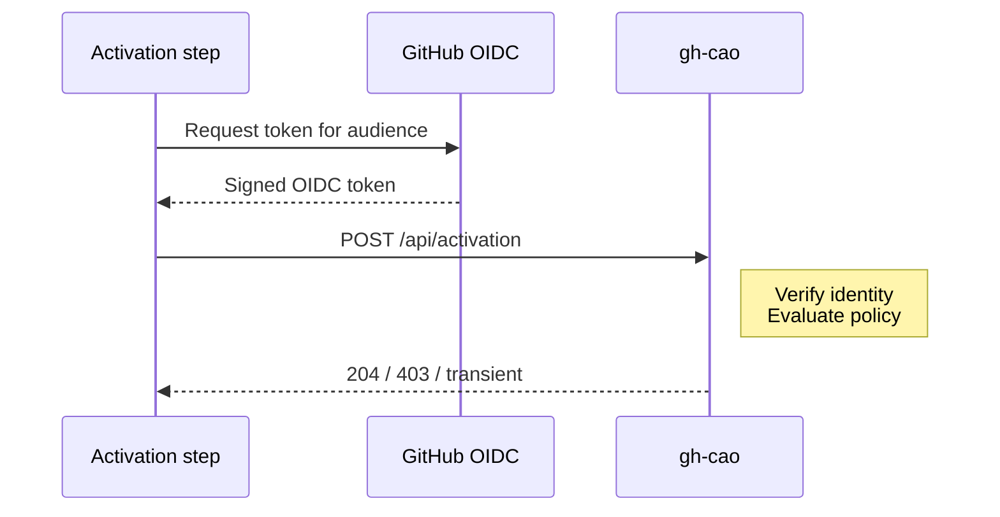
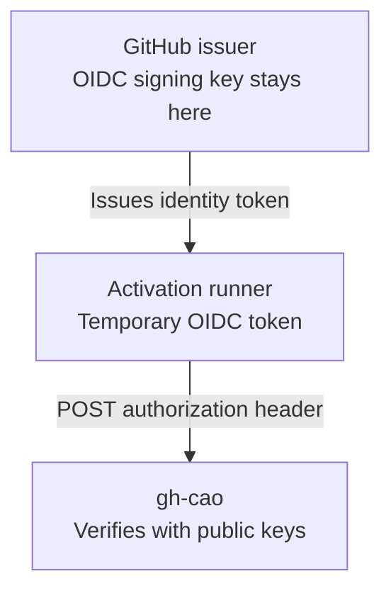
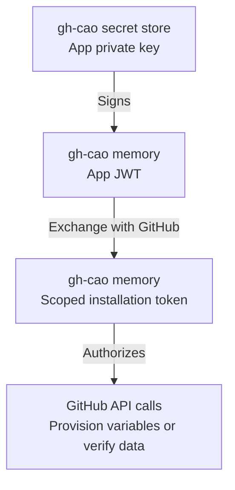

# AW Admission Service Specification

**Version**: 1.0 draft
**Status**: New feature proposal; no admission implementation yet in gh-aw or gh-cao
**Date**: 2026-10-19

The terms MUST, MUST NOT, SHOULD, and MAY indicate normative requirements. This document specifies a new feature. No admission client or service implementation exists yet; all admission-specific behavior described here remains to be implemented.

## 1. Scope and Ownership

The proposed feature adds admission as a step in gh-aw's existing activation job, before agent execution. It MUST NOT add a job or a new job dependency. Once implemented, gh-aw MUST include admission support by default: managed Actions variables automatically enable the check, without a separate opt-in flag. Without a configured endpoint, the step is skipped or completes as a successful no-op, and activation continues normally. gh-cao MUST implement the HTTPS admission service, trusted usage ingestion, policy evaluation, protected operator diagnostics, and optional configuration provisioning through its GitHub App.

The gate centrally decides whether an AW execution may start. It is not a billing API, spend-inspection endpoint, inference proxy, or mid-execution cancellation mechanism. A service decision alone cannot impose a hard upper bound on the cost of an already-running execution.

The protocol uses REST POST with a JSON body, authenticated exclusively by a GitHub Actions OIDC identity token with an audience restricted to the intended gh-cao deployment. The client MUST NOT send `GITHUB_TOKEN`, a PAT, Copilot token, GitHub App JWT, installation access token, App private key, API key, or custom activation credential to the admission service. The feature MUST support only this protocol, with no GET, alternate authentication mode, negotiation, or credential fallback.

## 2. Configuration and Provisioning

### Managed Environment Variables

Admission configuration MUST come exclusively from managed GitHub Actions variables, resolved at workflow runtime and passed to the admission step as environment variables. Repository JSON files and workflow/frontmatter configuration MUST NOT define or override admission settings. The compiler MUST register these variables with the existing `gh aw env get/update` mechanism:

| Actions variable | Managed YAML field | Built-in fallback |
|------------------|--------------------|-------------------|
| `GH_AW_DEFAULT_ADMISSION_URL` | `default_admission_url` | Empty; gate disabled |
| `GH_AW_DEFAULT_ADMISSION_AUDIENCE` | `default_admission_audience` | Effective endpoint URL |
| `GH_AW_DEFAULT_ADMISSION_ON_OUTAGE` | `default_admission_on_outage` | `ignore` |

The corresponding managed-defaults YAML is:

```yaml
default_admission_url: https://cao.example.com/api/activation
default_admission_audience: https://cao.example.com/api/activation
default_admission_on_outage: ignore
```

The service route is `/api/activation`; the deployment origin is configurable. A nonempty URL MUST be the full absolute HTTPS URL for that route, without embedded credentials, query parameters, fragments, or GitHub Actions expressions. A nonempty audience MUST be a literal deployment-specific value without control characters or expressions. It identifies the intended recipient; it is not a secret or a GitHub App identifier.

Each effective runtime variable takes precedence over its built-in fallback. Variable scope precedence follows the existing managed-default mechanism: repository, organization, then enterprise where supported. Compiler-process environment variables MUST NOT determine these values, and workflow-local configuration MUST NOT introduce another override layer. A configured endpoint automatically enables admission. An unset or empty endpoint makes the check a no-op; an audience or outage policy alone MUST NOT enable it. A nonempty but invalid endpoint MUST fail validation, not silently disable the check.

The compiler MUST always emit the runtime variable hooks, so enabling, disabling, or changing managed settings does not require recompilation after the feature is available in a compiled workflow. Existing managed-default update semantics remain unchanged: omitted or null YAML fields delete the corresponding variable at the selected scope. Operators MUST preserve other defaults when updating a defaults file.

Managed defaults are not an unoverrideable enterprise policy. A principal able to override them can change the recipient, audience, or outage behavior. Mandatory enforcement requires separately protected workflow/configuration controls, authorized workflow identities, and server-side policy. HTTPS validation alone does not establish an approved destination; deployments SHOULD enforce approved origins and runner egress independently.

### GitHub App Responsibilities

The gh-cao GitHub App requires a private key. That key MUST remain in gh-cao's protected server-side secret storage, with access control, rotation, and audit. It MUST NOT be distributed to workflows, Actions variables, workflow secrets, artifacts, or responses.

The service uses the key to sign an App JWT and obtain installation access tokens for permitted GitHub API operations. Those tokens are backend credentials, not caller credentials. Provisioning tokens SHOULD be downscoped to configuration operations; verification tokens SHOULD be downscoped to required reads.

With administrator authorization and suitable GitHub permissions, the App MAY provision the admission URL, audience, and outage defaults at supported organization/repository scopes. Enterprise defaults use the supported enterprise administration path; App support for writing every scope MUST NOT be assumed. Unsupported provisioning MUST be reported to the administrator, not silently bypassed.

Only non-secret configuration is provisioned. App IDs and installation IDs do not authenticate a workflow. The App does not mint the workflow's OIDC token.

## 3. Activation Step and Request Contract

gh-aw MUST add the admission step to the existing activation job after applicable trigger/authorization prechecks, trusted setup, and execution-context initialization, but before agent execution and cost-incurring task work. The step MUST use trusted, pinned bootstrap and admission code, not execute repository-supplied task scripts. No separate admission job is created.

The activation job MUST gain `id-token: write` to request OIDC tokens, while retaining only the GitHub API permissions required by its other steps. Permissions are job-scoped, not step-scoped; the admission step MUST NOT use or forward the activation job's GitHub API token or other available secrets. When no effective endpoint exists, the step MUST be skipped or succeed as a no-op without requesting an identity token or making a service call. Skipping the step MUST NOT skip activation or its downstream jobs. A blocking admission failure MUST fail activation and prevent agent execution through the existing activation-success dependency.

The entire activation job is an OIDC trust boundary, not just the admission step. All custom setup, pre, and regular steps and actions, before and after admission, MUST be reviewed as able to request identity tokens for other audiences. Skipping admission does not revoke the job's OIDC capability. The implementation MUST prevent untrusted code from executing in this job and review existing federated relying-party policies before granting the permission; an admission-step condition is not a permission sandbox. This requirement MUST be met without adding a job.

For an enabled gate, the step requests an OIDC token from GitHub using the effective audience, for example with `core.getIDToken(audience)`. GitHub supplies the OIDC request capability to jobs with `id-token: write`; no GitHub App private key is needed in the runner. OIDC bootstrap credentials are used only with the trusted GitHub OIDC endpoint and MUST NOT be forwarded to gh-cao.

### Protocol Flow



The step runs inside activation, not in a new job. No endpoint means no token or request. `204` continues activation; `403` fails it. Only transient failures are retried, then handled by the outage policy. The existing activation-success dependency still gates the agent. Token reuse or renewal does not create another entitlement.

### HTTP Request

The service accepts `POST /api/activation`, with `content-type: application/json`, `cache-control: no-store`, and an `authorization` header containing the bearer OIDC identity token. Execution metadata belongs in the JSON body, not the URL. There are no query parameters. Other HTTP methods MUST NOT admit execution or evaluate spending policy; the client MUST NOT fall back to GET.

```http
POST /api/activation HTTP/1.1
content-type: application/json
cache-control: no-store
traceparent: 00-4bf92f3577b34da6a3ce929d0e0e4736-00f067aa0ba902b7-01

{
  "repo": "acme/project",
  "workflow_id": "triage",
  "workflow_call_id": "1234-2:triage",
  "run_id": "1234",
  "run_attempt": "2",
  "ref": "refs/heads/main",
  "event_type": "workflow_dispatch",
  "actor": "octocat"
}
```

The `authorization` header is omitted from this example. It MUST be present on actual requests, and the token MUST appear nowhere else, including the body, URL, trace context, diagnostics, outputs, artifacts, or response. Redirects MUST NOT be followed.

### Proxy-Friendly Header Conventions

Emit lowercase HTTP field names and accept them case-insensitively. Use the standard W3C `traceparent` field through an OpenTelemetry propagator, not `trace-parent`, `otel-traceparent`, or `x-trace-id`. The standard request fields are `authorization`, `content-type`, `cache-control`, and `traceparent`.

Any future custom header MUST use the lowercase `gh-aw-` namespace followed by ASCII alphanumeric, hyphen-separated words: `gh-aw-[a-z0-9]+(?:-[a-z0-9]+)*`. Do not use underscores, spaces, dotted OTel attribute names, or an `x-` prefix. This protocol defines no custom headers; the trace ID already supplies correlation, without a second identifier.

Proxies and API gateways MUST allow and preserve the standard fields, without appending or comma-joining `traceparent` values, rewriting trace IDs, or caching admission responses. They MUST NOT forward arbitrary caller headers or use forwarded-host headers to select an issuer, audience, or tenant. Document transport limits that accommodate valid GitHub OIDC tokens and trace context. Infrastructure header/body limits still apply before protocol processing.

### JSON Request Fields

All eight fields are required exactly once in a UTF-8 JSON object. Every value is a string, including run IDs and attempt numbers:

| Field | Meaning and validation |
|-------|------------------------|
| `repo` | Current execution's `owner/repository` slug; MUST match signed repository identity |
| `workflow_id` | Compiled AW logical workflow ID, matching `aw_info.workflow_id`; not a numeric GitHub workflow ID |
| `workflow_call_id` | Exactly `<run_id>-<run_attempt>:<workflow_id>`, matching `aw_info.workflow_call_id` |
| `run_id` | Positive decimal GitHub Actions run ID; preserve as a string |
| `run_attempt` | Positive decimal attempt number; MUST match the signed claim |
| `ref` | Current GitHub Actions ref; MUST match the signed claim |
| `event_type` | Current GitHub Actions event name; MUST match the supported signed event claim |
| `actor` | Current `github.actor` login; MUST match the signed actor claim |

The actor is the original run actor, not the rerun initiator represented by `github.triggering_actor`. Actor-specific authorization MUST use verified actor identity, including signed `actor_id`, not the request field alone.

The client derives fields from the current runner context and compiled workflow ID, not caller-supplied `aw_context`. It sends no full event payload, arbitrary inbound context, usage, balances, or policy values. Original triggering-event lineage is not part of this protocol.

The service MUST reject missing, duplicate, unknown, malformed, empty, or oversized fields, non-object bodies, non-string values, unsupported content types, and request query parameters. It MUST impose documented body/header limits and SHOULD support an 8 KiB JSON body. Invalid UTF-8, control characters, invalid repository slugs, non-positive run numbers, or inconsistent invocation IDs receive the uniform denial. Body values MUST NOT be interpreted as executable expressions, outbound URLs, or credential selectors.

Opaque identifiers and refs MUST NOT be unnecessarily lowercased or split. Large decimal identifiers MUST NOT pass through floating-point conversion.

### OpenTelemetry Correlation

The client MUST propagate correlation with the standard W3C `traceparent` header. Its 32-character lowercase hexadecimal trace ID is the correlation ID; no independent custom correlation header or JSON field is required. The version-00 form is `00-<trace-id>-<client-span-id>-<trace-flags>`, with a nonzero trace ID and a nonzero 16-character span ID. Implementations MUST use a standards-compliant propagator rather than interpolate arbitrary input.

Reuse a valid AW trace context through the existing OTLP helpers. If none exists, generate a cryptographically random trace ID, never one derived from repository, actor, run, spend, or a credential. An admission operation and its HTTP attempts share the trace ID; each HTTP attempt has a distinct client span ID. gh-cao creates a server span parented to that attempt. A new trace MUST be available for correlation even when span export is disabled.

The step MUST preserve the activation job's existing trace context and propagate validated trace/parent IDs through the existing workflow mechanism so agent and conclusion telemetry remain connected. If the step creates a trace because none exists, it MUST initialize that mechanism rather than add a job or dependency. Logs use the same `trace_id` and `span_id`; correlation MUST NOT substitute for authenticated invocation identity or an idempotency key. Trace IDs MUST NOT be high-cardinality metric labels or grant access to another tenant's traces.

Trace context is untrusted observability data, not an authorization claim. Within overall HTTP transport limits, missing, malformed, oversized, or duplicate trace context MUST NOT change admission or outage decisions: gh-cao discards it and starts a fresh context without echoing or logging raw invalid values. Export failures MUST NOT change the decision, disable the check, or cause another admission request.

Only `traceparent` is propagated across this boundary. Arbitrary `tracestate` and `baggage` MUST NOT be forwarded or reflected; received values are ignored. Sampling is locally controlled and independent of spend, actor privileges, or an attacker-supplied sampled flag. Credentials, policy reasons, usage, balances, and personal metadata MUST NOT be encoded in trace identifiers or propagation headers.

Responses do not echo trace headers or disclose an internal diagnostic identifier. The client MAY expose its validated opaque correlation ID independently of the admission result for support. Detailed service reasons remain in protected, tenant-scoped telemetry and MUST NOT appear in workflow-visible span attributes or events.

## 4. Authentication and Trust Boundary

### Secret Locations and Credential Flow

Workflow identity:



Backend App credentials:



The App private key and installation tokens never go to the runner. The key signs App JWTs, not workflow OIDC tokens. Managed variables contain only non-secret configuration. The runner's OIDC bootstrap credential is used only with GitHub; `GITHUB_TOKEN` and provider secrets are not used by admission. Transient tokens MUST NOT enter logs, traces, artifacts, or decision storage. All activation steps share the job's OIDC issuance capability, including when the admission step is skipped.

### OIDC Verification

The service MUST authenticate before reading tenant policy or usage. It MUST use a maintained JWT verifier and validate the signature, permitted algorithm, trusted GitHub issuer, exact configured audience, expiry, not-before, and issuance time with bounded clock skew. Unsigned tokens, algorithm confusion, missing required claims, and unexpected claim types MUST be rejected.

Issuer metadata and signing keys MUST come from a deployment-configured trusted GitHub issuer. The service MUST NOT discover an issuer, JWKS endpoint, GitHub API host, or network destination from unverified token, body, or trace data. Signing-key rotation and cache refresh MUST be bounded and tested. An unknown key triggers a bounded trusted refresh; inability to refresh is an outage, while a definitively invalid signature or key is a denial.

The expected audience MUST be configured independently in gh-cao. It MUST NOT be accepted merely because it matches a request parameter or the token's own `aud` claim. GitHub.com and each supported GitHub Enterprise deployment require explicit issuer/trust configuration; unsupported deployments receive no credential downgrade.

### Invocation and Tenant Binding

Authorization MUST use signed immutable `repository_id` and `repository_owner_id`, trusted tenant enrollment, and allowed workflow identities. A valid GitHub signature alone does not authorize an arbitrary repository or tenant.

The service MUST compare repository, run ID, attempt, ref, event, and actor body fields against verified claims. It MUST validate signed `workflow_ref` and `workflow_sha` and, for reusable workflows, `job_workflow_ref` and `job_workflow_sha` where applicable. Required claims and equality rules MUST be verified for each supported deployment and trigger; unavailable or ambiguous identity MUST NOT select weaker policy.

OIDC does not directly attest gh-aw's logical `workflow_id` or derived `workflow_call_id`. gh-cao MUST establish an authorized mapping from the verified workflow identity to the logical AW ID, through protected policy or authoritative workflow data at the verified revision. The claimed logical ID alone MUST NOT select a more permissive budget or tenant. An unknown mapping receives a conservative repository policy or denial.

Backend GitHub API checks MAY validate run state, enrollment, or mappings using gh-cao's own appropriately scoped App installation token. Successful reads of public repository/run data alone are not caller authentication. Backend credentials MUST NOT replace verification of the incoming OIDC identity.

OIDC remains a bearer credential: possession permits replay to the intended audience until expiration. It is not proof of a unique HTTP request or permission for a financial mutation. The service MUST enforce invocation binding, bounded replay handling, and spend-independent probe controls.

### Credential Handling

The service MUST discard the caller token after request processing. It MUST NOT persist raw tokens, token hashes, OIDC bootstrap credentials, or App credentials in logs, queues, decision records, traces, metrics, or exception capture. Parsed non-secret claims MAY be retained only where necessary under the metadata controls in Section 9.

The admission endpoint MUST reject GitHub API tokens and App credentials. Failure to acquire or verify OIDC MUST NOT trigger an API-token, App-token, or shared-secret fallback.

## 5. Response Contract

An admitted response MUST be `204 No Content` with no response body.

| Status | Meaning | Client behavior |
|--------|---------|-----------------|
| `204` | Admitted | Continue activation; agent execution remains gated on activation success |
| `403` | Uniform authentication, authorization, validation, or policy denial | Block immediately; no retry |
| `408`, `429`, `500`-`599` | Transient service failure | Retry, then apply configured outage policy |
| Any other status, including redirects and other `2xx` | Not admitted or unsupported response | Block immediately; no retry |

The service MUST use the same empty `403` for invalid credentials, claim mismatches, inaccessible or unknown repositories/runs, disabled or unconfigured tenants, unknown policies, exhausted budgets, and all other durable denials. It MUST NOT encode spend or denial reasons in status, body, or headers.

When trusted OIDC, GitHub, usage, policy, or storage dependencies are temporarily unavailable, the service MUST return a generic transient status, normally `503`, rather than fabricate admission or denial. Operational rate limiting MAY return `429` only independently of spend. Budget thresholds, concurrency policy, or reset windows MUST NOT be represented as `429`, `5xx`, or `Retry-After`, which could activate fail-open behavior.

Every response MUST set `cache-control: no-store`, have an empty body, and omit budget, quota, reset, policy, and internal-correlation headers. The service MUST NOT redirect or request another credential.

## 6. Retries, Outages, and Availability

The client makes at most three attempts. Each admission HTTP request has a ten-second timeout; OIDC acquisition MUST also have a bounded deadline. Network errors, timeouts, `408`, `429`, and `5xx` are transient. Backoff is 250 ms, then 500 ms, each plus 0-249 ms random jitter. JSON body identity, audience, and correlation trace ID remain unchanged; each HTTP attempt has its own span ID. Response headers do not affect retry timing.

A still-valid identity token MAY be reused across retries. If renewal is necessary, it MUST preserve the same verified invocation identity and MUST NOT expand the attempt budget. OIDC issuer transport failures MAY use the outage policy; missing `id-token: write`, missing bootstrap credentials, invalid local configuration, malformed identity, and explicit authentication failures MUST block without fallback.

An explicit denial after a transient failure terminates retries and blocks. After transient attempts are exhausted:

| Policy | Result |
|--------|--------|
| `ignore`, including omitted configuration | Emit a generic warning, complete the step successfully without an affirmative decision, and continue activation |
| `block` | Fail the admission step and activation job; do not start the agent |

The client discards response bodies without parsing them. Blocking failures expose only `ERR_ADMISSION` and a generic message; ignored outages expose a generic `ERR_ADMISSION` warning. Neither path prints statuses, headers, bodies, tokens, issuer diagnostics, or transport exceptions.

The service SHOULD complete within two seconds under expected load and MUST bound dependencies below the client's ten-second HTTP deadline. It MUST remain safe when timeouts and retries reach different instances.

Default `ignore` explicitly trades enforcement for availability. Strict deployments MUST select and protect `block`. No service-only implementation can override a client choice to bypass outages.

## 7. Cost-Control Decisions

gh-cao owns policy configuration and trusted usage aggregation. Policies MAY impose organization, repository, verified-workflow, or verified-actor controls. Spending limits and windows are protected operator configuration, not part of the public API.

The implementation MUST define accounting units, authoritative usage sources, freshness bounds, policy precedence, time windows, and handling of active executions. It MUST NOT implicitly mix AI Credits, token counts, and currency. Missing, stale, or unavailable usage MUST NOT silently become zero.

Disabled or unconfigured tenants and unsupported policy selectors are durable denials. Temporary inability to load configured policy or fresh accounting is an outage. This distinction MUST depend on operational state, not whether a hidden spend threshold was crossed. Applicable controls MUST use a consistent policy/usage snapshot.

### Retry Safety and Accounting Limits

Although the request uses POST, this admission operation MUST remain retry-safe and MUST NOT charge credits, decrement budgets, reserve funds, create paid executions, or modify billing state. Protected request logs and short-lived decision caching are permitted; repeated requests MUST NOT create repeated financial commitments or imply that an agent actually started.

Admission is a start-time check. Concurrent executions can observe the same remaining budget and overshoot it without independent in-flight accounting. gh-cao MUST document its concurrency/overshoot model and MUST NOT advertise a hard spend cap based solely on this endpoint. Reservations or settlement require a separately designed mutation protocol.

## 8. Idempotency and Replay

The decision key MUST include trusted GitHub issuer/deployment, signed canonical repository ID, run ID, run attempt, verified workflow identity, and its authorized logical AW ID. The claimed `workflow_call_id` MUST be checked but MUST NOT be the sole key.

Concurrent retries across service instances MUST NOT multiply financial or execution-accounting effects. A completed allow/deny decision SHOULD be retained for the short retry horizon, with bounded retention, expiry, and an explicit revocation strategy. A cached admission MUST NOT outlive its configured authorization window or admit a different invocation, workflow hop, or run attempt.

Where token identifiers such as `jti` are used, repeated requests for the same invocation MUST remain compatible with legitimate retries. A blanket one-use-token rule MUST NOT reject those retries; token renewal MUST NOT create a fresh policy/accounting entitlement. Transient failures MUST NOT be cached as admission or policy denial.

## 9. Privacy and Abuse Resistance

The public result reveals eligibility, not spending level or denial reason. Complete secrecy is impossible: legitimate repeated probes can reveal eligibility changes. OIDC does not eliminate this oracle. Authenticate and authorize before policy lookup, bound probes independently of spend, and document the residual disclosure.

All durable denials MUST share status, empty body, header set, and response-size behavior across spend bands and policy reasons. Timing MUST NOT intentionally depend on spend. Implementations SHOULD use a common response path, a bounded spend-independent timing envelope, and distribution tests rather than claim constant-time networking.

The service MUST NOT offer anonymous balance checks, threshold-specific codes, amount-dependent retry timing, spend-based cache validators, or budget-reset headers. Proxies, CDNs, API gateways, and tracing MUST preserve these rules. Shared intermediary caching is prohibited.

The `authorization` header and raw tokens MUST be redacted before telemetry or request sampling. POST bodies contain repository, ref, actor, and execution metadata: body capture MUST be disabled or redacted in ingress/access logs, traces, and exceptions by default. Trace correlation does not authorize raw header/body logging. Necessary structured metadata MUST be minimized, tenant-scoped, access-controlled, and retention-bounded. Actor logins and IDs are identifying data, not public diagnostic labels.

Protected operator reason codes and accounting diagnostics MAY be stored separately without credentials. They MUST NOT be reflected into workflow responses, URLs, artifacts, or public metrics. Cross-tenant reads are prohibited.

## 10. Acceptance Tests

Both implementations MUST provide automated coverage before rollout:

| ID | Case | Required result |
|----|------|-----------------|
| ADM-001 | `POST /api/activation` with valid OIDC identity, audience, enrollment, and permitted invocation | Empty `204`, `cache-control: no-store` |
| ADM-002 | Missing token, GitHub API token, App credential, bad signature/algorithm, wrong issuer/audience, expired or premature token | Same empty `403`; no credential fallback |
| ADM-003 | Different hidden spend bands and durable denial reasons | No reason/amount differences in status, body, headers, size, or intentional timing |
| ADM-004 | Missing/duplicate/unknown/malformed JSON field, non-string value, query parameter, invalid content type, or inconsistent invocation ID | Uniform `403`; no unsafe downstream calls |
| ADM-005 | JSON slashes, Unicode/reserved characters, escapes, and large decimal ID strings | Parse once without injection, truncation, or precision loss |
| ADM-006 | Forged repository, run, attempt, ref, event, actor, or logical workflow ID | No favorable bypass of verified identity or tenant controls |
| ADM-007 | OIDC/JWKS, GitHub, usage, policy, or storage outage | Bounded retry/outage behavior, not fabricated policy results |
| ADM-008 | Network glitch or `503`, followed by admission | Retry within limits with unchanged identity/audience |
| ADM-009 | Exhausted transient failures | Default/`ignore` warns and continues activation; `block` fails activation and prevents agent execution |
| ADM-010 | Explicit `403`, including after an outage | Block without further retries under either policy |
| ADM-011 | Redirect, unexpected `200`, or another unsupported response | Block; no credential sent to any redirect destination |
| ADM-012 | Sensitive diagnostics in a faulty response or issuer exception | No workflow-visible credential or diagnostic leakage |
| ADM-013 | Duplicate POSTs, token reuse/renewal, and lost responses across instances | Retry-safe decisions; no additional financial entitlement |
| ADM-014 | Reruns and reusable workflow hops | Correct signed identities, authorized mappings, and distinct decision keys |
| ADM-015 | Stale accounting and concurrent executions | No implicit zero usage or unsupported hard-cap claim |
| ADM-016 | Proxy logs, tracing, exceptions, artifacts, outputs, and metrics | No raw token/App-key leakage or body capture; actor metadata minimized and protected |
| ADM-017 | Budget denial versus operational rate limiting | Budget denial is `403`; `429` is spend-independent |
| ADM-018 | Sustained outage under both policies | Fail-open limitation explicit; strict deployment verifies protected `block` |
| ADM-019 | Endpoint in repo/org/enterprise managed variables, without any opt-in flag | Step automatically runs in activation with runtime scope precedence; no new job, repository-file override, or compiler-environment capture |
| ADM-020 | No endpoint, or audience/policy without an endpoint | Step skips or succeeds as a no-op; no OIDC request or service call; activation and agent eligibility unchanged |
| ADM-021 | Missing job permission, invalid config, or unsupported claim set | Fail closed without requesting another credential |
| ADM-022 | App provisioning, private-key rotation, and unsupported scope | Server-only credentials; least privilege; explicit administrative errors |
| ADM-023 | Issuer key rotation and malicious token key/issuer URLs | Bounded trusted refresh; no token-controlled outbound discovery |
| ADM-024 | Original actor versus rerun initiator; unauthenticated public run read | Correct actor binding; neither body claims nor public reads establish authorization |
| ADM-025 | GET or another unsupported method; nonempty malformed endpoint | No method fallback or spending-policy evaluation; invalid configuration never becomes a no-op |
| ADM-026 | Valid W3C context, retries, and downstream jobs | Stable correlation trace ID; distinct HTTP attempt spans; connected client/server and workflow telemetry |
| ADM-027 | Missing/invalid/oversized trace context within transport limits, baggage, forced sampling, or export failure | No authorization change, raw metadata leakage, extra admission request, or attacker-controlled expensive sampling |
| ADM-028 | Custom activation hooks/actions before or after admission, including a skipped gate | Entire job reviewed for OIDC access; untrusted code excluded; skipping admission is not treated as permission revocation |
| ADM-029 | HTTP/1.1 and HTTP/2 proxy traversal, field-name casing, duplicate trace fields, and transport limits | Standard lowercase names emitted; case-insensitive handling; preserved single trace context; no underscore-header dependency or raw credential logging |

Tests MUST use synthetic credentials and accounting fixtures, not production secrets or real spend. Supported GitHub deployments, triggers, and reusable-workflow paths MUST have an explicit verified claim matrix.

## 11. Implementation Plan

1. **gh-aw managed configuration:** register the three new admission variables and their managed YAML keys with repo/org/enterprise handling, runtime scope precedence, and effective-value validation. Do not add repository JSON or workflow/frontmatter admission settings. Always include runtime variable hooks; automatically check when an endpoint is configured and no-op otherwise, without a separate opt-in flag. Add CLI coverage, enterprise reference, and release notes together.
2. **gh-aw activation integration:** add the new admission step to the existing activation job and grant that job `id-token: write`. Review every activation hook/action and existing federated trust policy for that job-wide capability, including when the gate is skipped. Preserve other required permissions without forwarding API credentials. Cover enabled, disabled, denied, and fail-open behavior, reusable workflows, and custom job conditions through existing activation-success dependencies. Do not add a job or new job dependency.
3. **gh-aw OIDC client:** implement bounded GitHub OIDC acquisition and the POST/JSON contract as new functionality. Include actor, accept only `204`, implement generic diagnostics, retries, and outage policy, and prohibit alternate credentials or HTTP methods.
4. **gh-cao service:** implement pinned issuer/audience verification, tenant enrollment and trusted workflow mapping, App-backed verification where needed, privacy-preserving policy evaluation, bounded decisions/replays, and protected telemetry. Keep the admission operation financially side-effect-free and retry-safe.
5. **gh-cao provisioning:** keep the App private key server-side; provide authorized default provisioning, scope/permission checks, key rotation, and operator guidance distinguishing defaults from mandatory enforcement.
6. **Trace correlation:** reuse gh-aw's OTLP trace generation/validation and workflow propagation helpers, inject W3C `traceparent` for each POST attempt, join gh-cao server spans, and enforce tenant-scoped telemetry and propagation redaction. Correlation works without an exporter and never becomes an authorization or accounting key.
7. **Integration and initial release:** satisfy Section 10 across both new implementations; verify issuer/audience registration, claim mappings, ingress redaction, endpoint governance, trace continuity, and `block` for strict deployments. Recompile workflows with the feature-capable compiler to include the new activation step and runtime configuration hooks. There is no prior admission implementation to migrate or support.

Integration points are the existing [activation-job assembly](../pkg/workflow/compiler_activation_context.go), [activation permissions](../pkg/workflow/compiler_activation_permissions.go), and [managed-default registry](../pkg/cli/env_command.go). Admission-specific compiler/runtime code and tests MUST be created; the repository configuration schema MUST NOT gain admission fields.

Platform references: [GitHub Actions OIDC claims and trust configuration](https://docs.github.com/en/actions/reference/security/oidc), [GitHub App private-key management](https://docs.github.com/en/apps/creating-github-apps/authenticating-with-a-github-app/managing-private-keys-for-github-apps), [W3C Trace Context](https://www.w3.org/TR/trace-context/), and [RFC 6648 header-naming guidance](https://www.rfc-editor.org/rfc/rfc6648.html). Existing emit-side integration points include [`send_otlp_span.cjs`](../actions/setup/js/send_otlp_span.cjs) and [`action_setup_otlp.cjs`](../actions/setup/js/action_setup_otlp.cjs).
